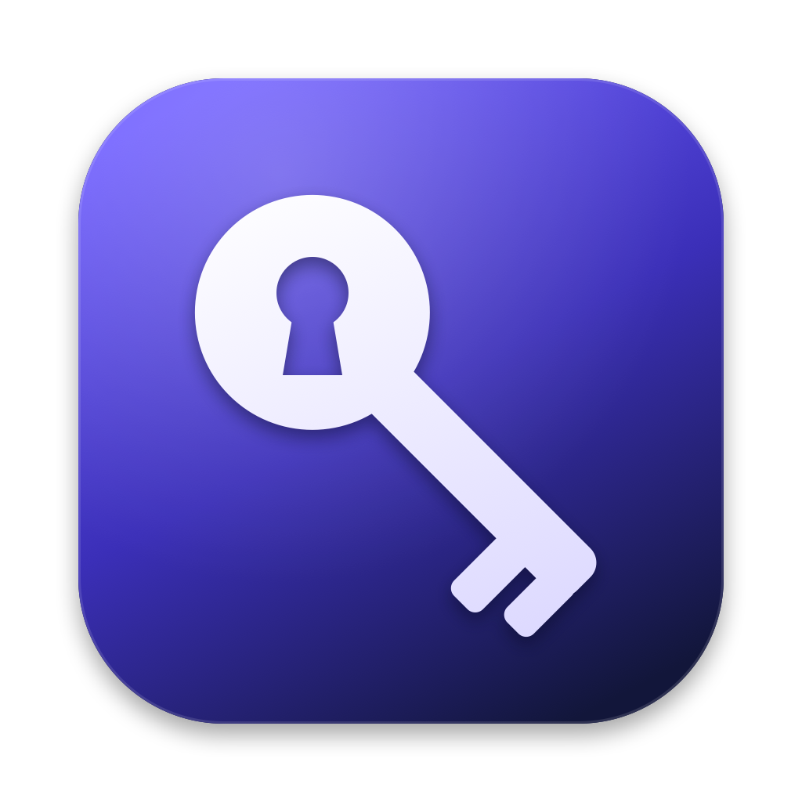
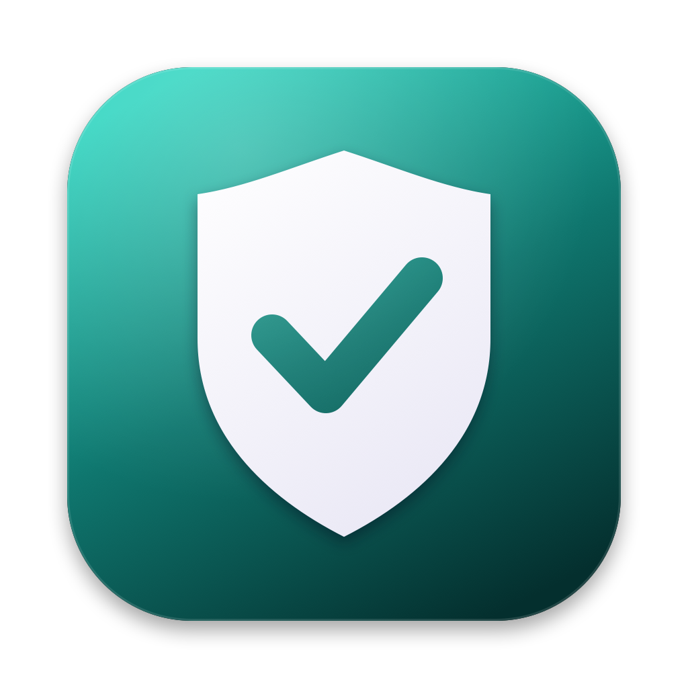
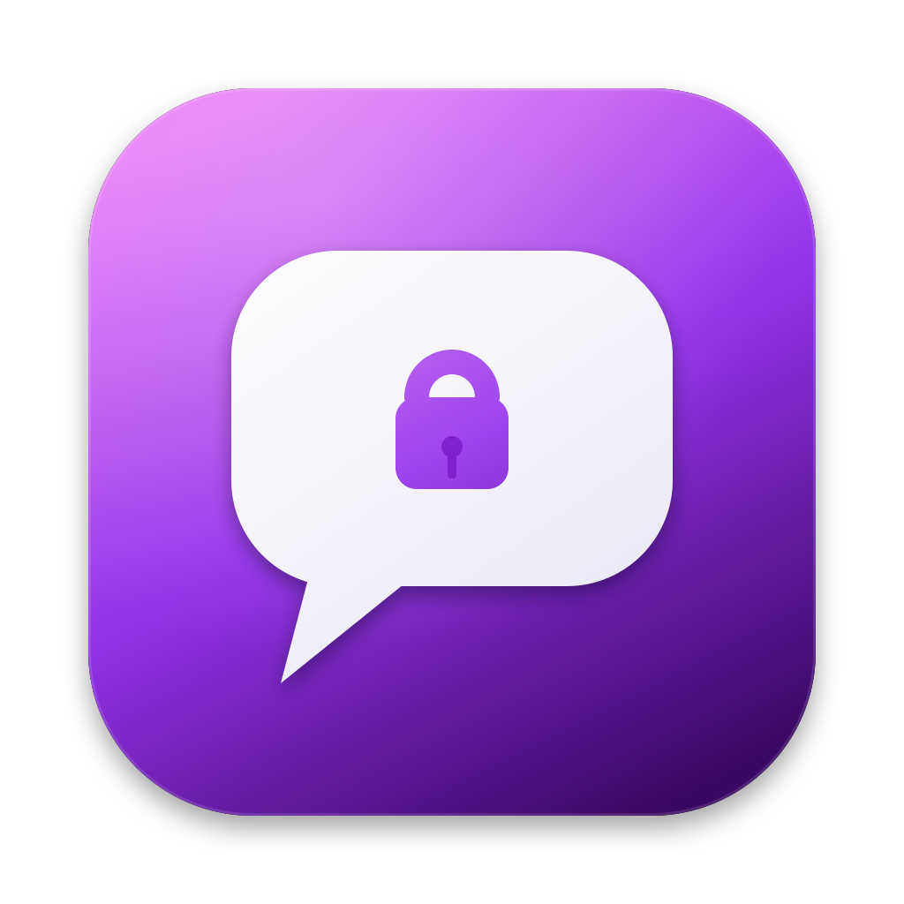

# ai-tools

A growing collection of small, practical tools for people who build with AI. They're **privacy-first**: they run on your Mac and keep your data there.

## What's inside

| | Tool | What it does |
|---|---|---|
|  | **[KeyVault](keyvault/)** | An encrypted vault for your API keys (OpenAI, Anthropic, Stripe and others). AES-256-GCM encryption, auto-lock, a self-clearing clipboard and built-in backups. Can optionally hand one key to your scripts or AI agents, only when you approve. |
|  | **[LeakGuard](leakguard/)** | Finds API keys that leaked into your code, including ones buried in old git commits, and installs a git hook that blocks new leaks. Can also check for your exact KeyVault keys. |
|  | **[Redact](redact/)** | Replaces names, emails, phone numbers, card numbers and keys with placeholders before you paste text into an AI, then puts the real values back into the AI's answer. |
|  | **[ChatKeep](chatkeep/)** | Imports your ChatGPT and Claude exports into one encrypted, searchable archive on your Mac, and scans it for API keys and personal data you pasted into chats, including your exact KeyVault keys. |
|  | **[ContextPack](contextpack/)** | Bundles a code project into one prompt-ready block of text. It respects `.gitignore`, shows token counts, never reads `.env` or key files, and redacts secrets. |

All five are native macOS apps (macOS 14+) with no third-party dependencies. Each folder has its own README with setup steps, usage, and the attacks it was tested against.

### How they fit together

```
            KeyVault  ── stores your keys, encrypted
               │
               ▼
           LeakGuard  ── checks those keys never ended up in your code or git history

   Redact  ·  ContextPack  ── keep personal data and secrets out of what you send to AI

   ChatKeep  ── your past AI conversations, encrypted and searchable, with a check for
                anything sensitive you already sent (including your exact KeyVault keys)
```

## Requirements

| | |
|---|---|
| **A Mac** | macOS 14 Sonoma or later, Apple Silicon or Intel |
| **Apple's Command Line Tools** | Free, about 1 GB. They include `swift`, `git` and `python3`, which the build and tests use. Full Xcode is **not** needed |
| **Time and space** | A build takes 10 to 80 seconds per tool on an Apple Silicon Mac, and each app is under 4 MB. After you clone the repo, building needs no internet connection |

> **Where it has been tested.** All five tools were built and tested (574 automated checks) on an Apple Silicon Mac running a recent macOS. The minimum is set to macOS 14 and nothing is knowingly newer, but older macOS versions and Intel Macs haven't been tried. If a build fails for you, please [open an issue](https://github.com/tanmayhc7/ai-tools/issues) with the output.

## Getting started

**1. Install Apple's Command Line Tools** (skip this if `swiftc --version` already prints a version):

```bash
xcode-select --install
```

**2. Get the code.** Use a normal folder, not one that is synced by iCloud (Desktop and Documents can be), Dropbox or similar. Sync services can touch files during a build and interfere with code signing. The build scripts retry, but an unsynced folder avoids the problem.

```bash
mkdir -p ~/Developer && cd ~/Developer
```

```bash
git clone https://github.com/tanmayhc7/ai-tools.git && cd ai-tools
```

**3. Build the tool you want:**

```bash
cd keyvault && ./build.sh
```

```bash
open build/KeyVault.app
```

Or build all five in one go:

```bash
for tool in keyvault leakguard redact contextpack chatkeep; do (cd $tool && ./build.sh) || break; done
```

A build does four things: draws the app icon, runs the tool's automated tests (**if any test fails, it stops and builds nothing**), compiles the app, and signs it with a hardened-runtime ad-hoc signature. The result is `build/<Name>.app` inside the tool's folder.

> **Read it before you run it.** Each `build.sh` is short. It only uses Apple's own tools on files inside that tool's folder, and it downloads nothing. None of the five apps contains networking code or links a networking framework, so none of them connects to the internet.

### Installing the apps

A built app runs from where it is. To keep it with your other apps, so Spotlight and Launchpad find it, copy it into Applications:

```bash
cp -R keyvault/build/KeyVault.app /Applications/
```

| Tool | App to copy |
|---|---|
| KeyVault | `keyvault/build/KeyVault.app` |
| LeakGuard | `leakguard/build/LeakGuard.app` |
| Redact | `redact/build/Redact.app` |
| ContextPack | `contextpack/build/ContextPack.app` |
| ChatKeep | `chatkeep/build/ChatKeep.app` |

Because you built the app on your own Mac, macOS doesn't show an "unidentified developer" warning. If you instead copy a built app to *another* Mac (by AirDrop or zip), macOS will block it the first time: right-click it and choose **Open**, or just build it on that Mac.

### Where each tool keeps your data

| Tool | What it stores | Where |
|---|---|---|
| **KeyVault** | Your encrypted vault, 10 encrypted backups, and (only if you switch it on) the agent socket | `~/Library/Application Support/KeyVault/` |
| **ChatKeep** | Your encrypted archive and 3 encrypted backups | `~/Library/Application Support/ChatKeep/` |
| **LeakGuard** | Nothing. It reads your KeyVault vault only if you tick that option, and failed-password attempts count toward KeyVault's own lockout | none |
| **Redact** | Only which categories are switched on. Your text, placeholders and custom terms stay in memory and are gone when you quit | app preferences |
| **ContextPack** | Only your chosen output format | app preferences |

The vault and the archive live **outside** the repo folder, so updating, rebuilding or deleting the repo never touches them.

### Updating

Quit the app, pull the latest code, rebuild, and replace the installed copy. Remove the old app first: copying a new build on top of an old one merges the two instead of replacing it.

```bash
cd ~/Developer/ai-tools && git pull
```

```bash
cd keyvault && ./build.sh && rm -rf /Applications/KeyVault.app && cp -R build/KeyVault.app /Applications/
```

(Use the other tool's folder and app name in the same way.) Your data is untouched.

### Uninstalling

Quit the app, then delete it:

```bash
rm -rf /Applications/KeyVault.app
```

That leaves your data in place, so reinstalling picks up where you left off. **Only if you want the data gone for good**, also delete its folder. This can't be undone, and without the vault or archive file there is no way to recover its contents:

```bash
rm -rf ~/Library/Application\ Support/KeyVault
```

```bash
rm -rf ~/Library/Application\ Support/ChatKeep
```

Optionally clear a tool's saved preferences too (swap in `leakguard`, `redact`, `contextpack` or `chatkeep` for the other tools):

```bash
defaults delete local.keyvault.app
```

### Troubleshooting

| Problem | Fix |
|---|---|
| `swiftc: command not found`, or `xcode-select: error` | Run `xcode-select --install` and wait for it to finish. If it says the tools are already installed, open a new Terminal window and try again |
| `Permission denied: ./build.sh` | Run it with `bash build.sh` instead |
| `✗ … needs macOS 14` | Update macOS (System Settings → General → Software Update) |
| `✗ Code signing failed` | The folder is probably being synced (iCloud, Dropbox). Clone the repo to an unsynced folder such as `~/Developer` and build there |
| A test fails | The script stops on purpose, so you never get an app that failed its own checks. Please open an issue and paste the output |
| A build seems slow | Normal: every build re-runs all of that tool's tests before compiling (ChatKeep and KeyVault have the most, so they take the longest) |
| macOS says an app "is damaged" or can't be opened | You copied it from another Mac. Right-click → **Open**, or rebuild it on this Mac |
| Windows or Linux | Not supported: these are Mac apps |

### Reporting problems safely

Open an [issue](https://github.com/tanmayhc7/ai-tools/issues) for bugs, questions and ideas. **Never paste real API keys, vault files, ChatKeep archives or real conversations into an issue.** Describe what happened, or use made-up values.

## More to come 🚧

More tools are on the way. Star or watch the repo to hear about new ones.

Have an idea, or found a bug? [Open an issue](https://github.com/tanmayhc7/ai-tools/issues).
