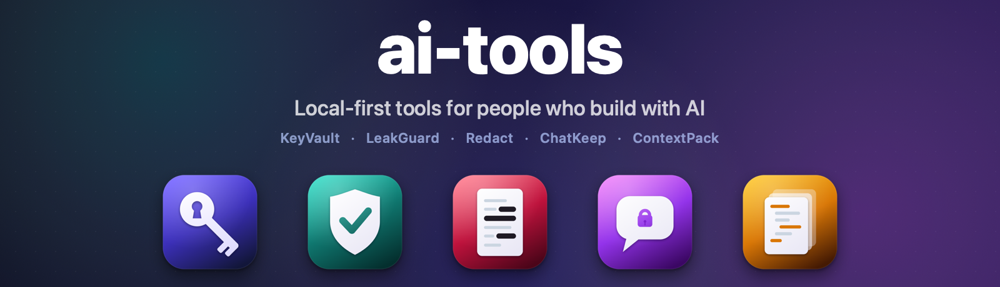
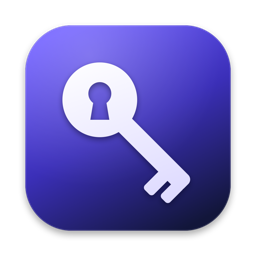
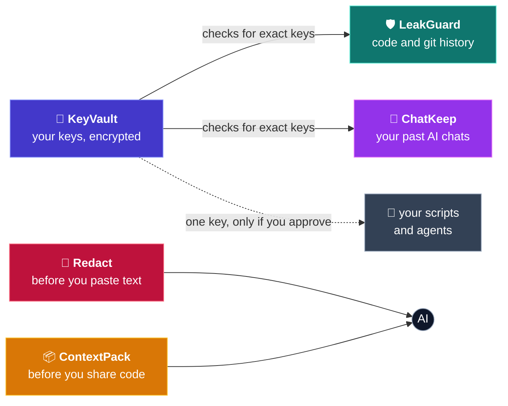

<p align="center">
  
</p>

<p align="center">
  
  
  
  
  
</p>

<h3 align="center">
  Five Mac apps that keep your keys, your conversations and your code out of harm's way.<br>
  Everything runs on your machine. Nothing is uploaded.
</h3>

<p align="center">
  <a href="#the-tools"><b>The tools</b></a> &nbsp;·&nbsp;
  <a href="#quick-start"><b>Quick start</b></a> &nbsp;·&nbsp;
  <a href="#installing-the-apps"><b>Install</b></a> &nbsp;·&nbsp;
  <a href="#updating"><b>Update</b></a> &nbsp;·&nbsp;
  <a href="#troubleshooting"><b>Troubleshooting</b></a>
</p>

<br>

<table>
<tr>
<td width="33%" valign="top">
<h4>🔒 Private by design</h4>
No accounts, no cloud, no networking code. Your keys and conversations never leave this Mac.
</td>
<td width="33%" valign="top">
<h4>🧪 Attacked on purpose</h4>
574 automated checks, including zip bombs, tampered files, hostile search queries and booby-trapped git repositories.
</td>
<td width="33%" valign="top">
<h4>🍎 Native and light</h4>
Real Mac apps, each under 4 MB, with no third-party code. Each one builds in under two minutes.
</td>
</tr>
</table>

## The tools

<table>
<tr>
<td width="110" align="center" valign="middle"><a href="keyvault/"></a></td>
<td valign="middle">
<h3><a href="keyvault/">KeyVault</a></h3>
<b>Your API keys, encrypted, on your Mac.</b><br>
AES-256-GCM vault with auto-lock, a self-clearing clipboard and encrypted backups. Can hand one key at a time to your scripts or AI agents, only when you approve each request.<br>
<sub>🔐 Encrypted vault &nbsp;·&nbsp; ⏱ Auto-lock &nbsp;·&nbsp; 🤖 Agent access (off by default)</sub>
</td>
</tr>
<tr>
<td width="110" align="center" valign="middle"><a href="leakguard/"></a></td>
<td valign="middle">
<h3><a href="leakguard/">LeakGuard</a></h3>
<b>Find the keys that leaked into your code.</b><br>
Scans a project and its entire git history for API keys, and installs a git hook that blocks new leaks. Can also look for your exact KeyVault keys.<br>
<sub>🔎 Files and history &nbsp;·&nbsp; 🪝 Pre-commit hook &nbsp;·&nbsp; 🛡 Safe on untrusted repos</sub>
</td>
</tr>
<tr>
<td width="110" align="center" valign="middle"><a href="redact/"></a></td>
<td valign="middle">
<h3><a href="redact/">Redact</a></h3>
<b>Use AI on real documents without handing over personal data.</b><br>
Swaps names, emails, phone numbers, card numbers and keys for placeholders before you paste, then puts the real values back into the AI's answer.<br>
<sub>🧾 Placeholders &nbsp;·&nbsp; ↩️ One-click restore &nbsp;·&nbsp; 🧠 On-device name detection</sub>
</td>
</tr>
<tr>
<td width="110" align="center" valign="middle"><a href="chatkeep/"></a></td>
<td valign="middle">
<h3><a href="chatkeep/">ChatKeep</a></h3>
<b>Your ChatGPT and Claude history, searchable and encrypted.</b><br>
Imports your exports into one archive on your Mac, searches everything at once, and scans it for API keys and personal data you pasted into chats.<br>
<sub>💬 ChatGPT and Claude &nbsp;·&nbsp; 🔍 Instant search &nbsp;·&nbsp; 🚨 Leak Check</sub>
</td>
</tr>
<tr>
<td width="110" align="center" valign="middle"><a href="contextpack/"></a></td>
<td valign="middle">
<h3><a href="contextpack/">ContextPack</a></h3>
<b>Turn a project into one prompt, safely.</b><br>
Bundles a code project into one block of text for any AI. Respects <code>.gitignore</code>, shows token counts, never reads <code>.env</code> or key files, and redacts secrets.<br>
<sub>📦 One-click bundle &nbsp;·&nbsp; 🔢 Token counts &nbsp;·&nbsp; 🙈 Secrets removed</sub>
</td>
</tr>
</table>

### How they fit together



<table>
<tr><th align="left">Tool</th><th align="left">Protects you from</th><th align="left">Keeps on disk</th></tr>
<tr><td><b>KeyVault</b></td><td>Keys in plain-text files, notes and chats</td><td>Encrypted vault and backups</td></tr>
<tr><td><b>LeakGuard</b></td><td>Keys committed to git, now or years ago</td><td>Nothing</td></tr>
<tr><td><b>Redact</b></td><td>Personal data in what you send to an AI</td><td>Only your switch settings</td></tr>
<tr><td><b>ChatKeep</b></td><td>Losing chat history, and keys already pasted into it</td><td>Encrypted archive and backups</td></tr>
<tr><td><b>ContextPack</b></td><td>Secrets in code you share with an AI</td><td>Only your format choice</td></tr>
</table>

## Requirements

| | |
|---|---|
| 🖥 **A Mac** | macOS 14 Sonoma or later, Apple Silicon or Intel |
| 🛠 **Apple's Command Line Tools** | Free, about 1 GB. They include `swift`, `git` and `python3`, which the build and tests use. Full Xcode is **not** needed |
| ⏱ **Time and space** | A build takes 10 to 80 seconds per tool on an Apple Silicon Mac, and each app is under 4 MB. After you clone the repo, building needs no internet connection |

> [!NOTE]
> **Where it has been tested.** All five tools were built and tested (574 automated checks) on an Apple Silicon Mac running a recent macOS. The minimum is set to macOS 14 and nothing is knowingly newer, but older macOS versions and Intel Macs haven't been tried. If a build fails for you, please [open an issue](https://github.com/tanmayhc7/ai-tools/issues) with the output.

## Quick start

**1. Install Apple's Command Line Tools** (skip this if `swiftc --version` already prints a version):

```bash
xcode-select --install
```

**2. Get the code.** Use a normal folder, not one synced by iCloud, Dropbox or similar.

```bash
mkdir -p ~/Developer && cd ~/Developer
```

```bash
git clone https://github.com/tanmayhc7/ai-tools.git && cd ai-tools
```

> [!TIP]
> iCloud's Desktop and Documents folders count as synced. Sync services can touch files during a build and interfere with code signing. The build scripts retry, but an unsynced folder such as `~/Developer` avoids the problem altogether.

**3. Build the tool you want:**

```bash
cd keyvault && ./build.sh
```

```bash
open build/KeyVault.app
```

Or build all five in one go:

```bash
for tool in keyvault leakguard redact contextpack chatkeep; do (cd $tool && ./build.sh) || break; done
```

A build does four things: draws the app icon, runs the tool's automated tests (**if any test fails, it stops and builds nothing**), compiles the app, and signs it with a hardened-runtime ad-hoc signature. The result is `build/<Name>.app` inside the tool's folder.

> [!IMPORTANT]
> **Read it before you run it.** Each `build.sh` is short. It only uses Apple's own tools on files inside that tool's folder, and it downloads nothing. None of the five apps contains networking code or links a networking framework, so none of them connects to the internet.

## Installing the apps

A built app runs from where it is. To keep it with your other apps, so Spotlight and Launchpad find it, copy it into Applications:

```bash
cp -R keyvault/build/KeyVault.app /Applications/
```

| | Tool | App to copy |
|---|---|---|
|  | KeyVault | `keyvault/build/KeyVault.app` |
|  | LeakGuard | `leakguard/build/LeakGuard.app` |
|  | Redact | `redact/build/Redact.app` |
|  | ChatKeep | `chatkeep/build/ChatKeep.app` |
|  | ContextPack | `contextpack/build/ContextPack.app` |

Because you built the app on your own Mac, macOS doesn't show an "unidentified developer" warning. If you instead copy a built app to *another* Mac (by AirDrop or zip), macOS will block it the first time: right-click it and choose **Open**, or just build it on that Mac.

## Where each tool keeps your data

| Tool | What it stores | Where |
|---|---|---|
| 🔑 **KeyVault** | Your encrypted vault, 10 encrypted backups, and (only if you switch it on) the agent socket | `~/Library/Application Support/KeyVault/` |
| 💬 **ChatKeep** | Your encrypted archive and 3 encrypted backups | `~/Library/Application Support/ChatKeep/` |
| 🛡 **LeakGuard** | Nothing. It reads your KeyVault vault only if you tick that option, and failed-password attempts count toward KeyVault's own lockout | none |
| 🧾 **Redact** | Only which categories are switched on. Your text, placeholders and custom terms stay in memory and are gone when you quit | app preferences |
| 📦 **ContextPack** | Only your chosen output format | app preferences |

The vault and the archive live **outside** the repo folder, so updating, rebuilding or deleting the repo never touches them.

## Updating

Quit the app, pull the latest code, rebuild, and replace the installed copy. Remove the old app first: copying a new build on top of an old one merges the two instead of replacing it.

```bash
cd ~/Developer/ai-tools && git pull
```

```bash
cd keyvault && ./build.sh && rm -rf /Applications/KeyVault.app && cp -R build/KeyVault.app /Applications/
```

Use the other tool's folder and app name in the same way. Your data is untouched.

## Uninstalling

<details>
<summary><b>Show the uninstall steps</b></summary>

<br>

Quit the app, then delete it:

```bash
rm -rf /Applications/KeyVault.app
```

That leaves your data in place, so reinstalling picks up where you left off.

⚠️ **Only if you want the data gone for good**, also delete its folder. This can't be undone, and without the vault or archive file there is no way to recover its contents.

```bash
rm -rf ~/Library/Application\ Support/KeyVault
```

```bash
rm -rf ~/Library/Application\ Support/ChatKeep
```

Optionally clear a tool's saved preferences too (swap in `leakguard`, `redact`, `contextpack` or `chatkeep` for the other tools):

```bash
defaults delete local.keyvault.app
```

</details>

## Troubleshooting

| Problem | Fix |
|---|---|
| `swiftc: command not found`, or `xcode-select: error` | Run `xcode-select --install` and wait for it to finish. If it says the tools are already installed, open a new Terminal window and try again |
| `Permission denied: ./build.sh` | Run it with `bash build.sh` instead |
| `✗ … needs macOS 14` | Update macOS (System Settings → General → Software Update) |
| `✗ Code signing failed` | The folder is probably being synced (iCloud, Dropbox). Clone the repo to an unsynced folder such as `~/Developer` and build there |
| A test fails | The script stops on purpose, so you never get an app that failed its own checks. Please open an issue and paste the output |
| A build seems slow | Normal: every build re-runs all of that tool's tests before compiling (ChatKeep and KeyVault have the most, so they take the longest) |
| macOS says an app "is damaged" or can't be opened | You copied it from another Mac. Right-click → **Open**, or rebuild it on this Mac |
| Windows or Linux | Not supported: these are Mac apps |

## Reporting problems safely

Open an [issue](https://github.com/tanmayhc7/ai-tools/issues) for bugs, questions and ideas.

> [!CAUTION]
> **Never paste real API keys, vault files, ChatKeep archives or real conversations into an issue.** Describe what happened, or use made-up values.

<br>

<p align="center">
  <b>More tools are on the way.</b><br>
  ⭐ Star or watch the repo to hear about new ones &nbsp;·&nbsp; 💡 <a href="https://github.com/tanmayhc7/ai-tools/issues">Share an idea</a>
</p>
