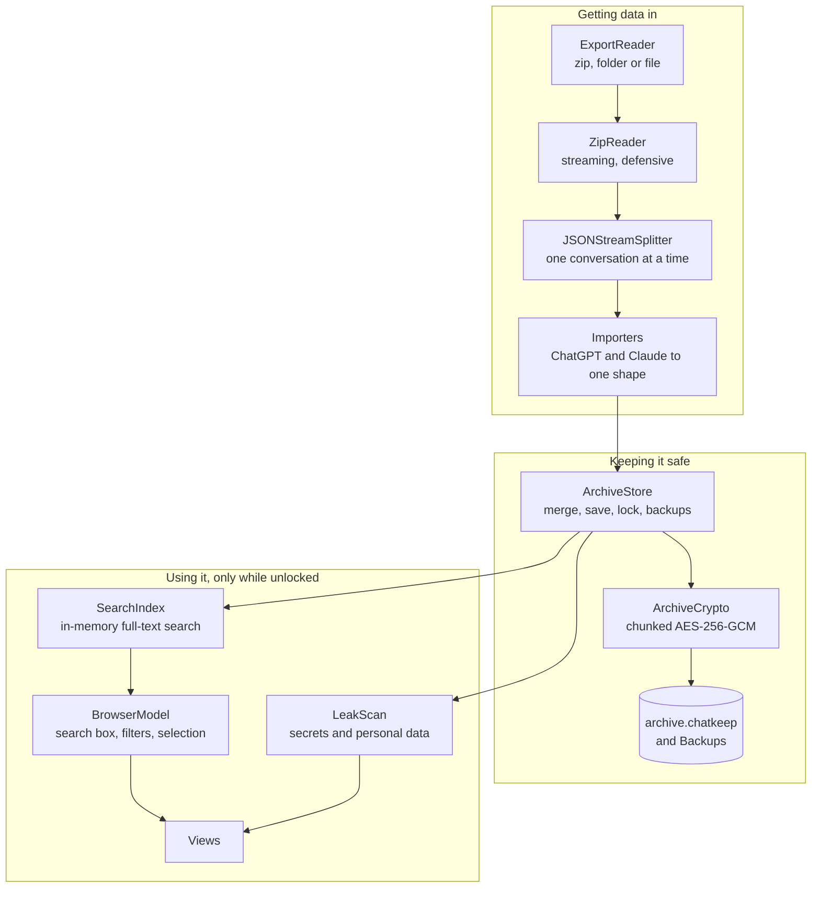
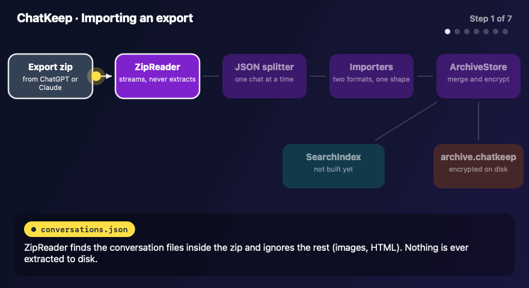
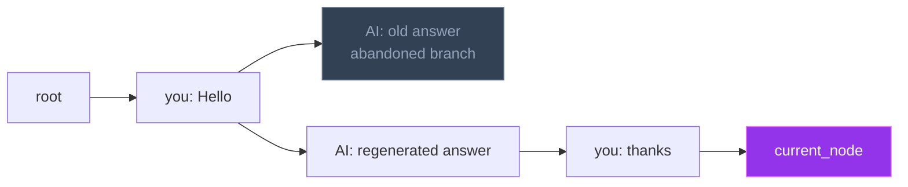
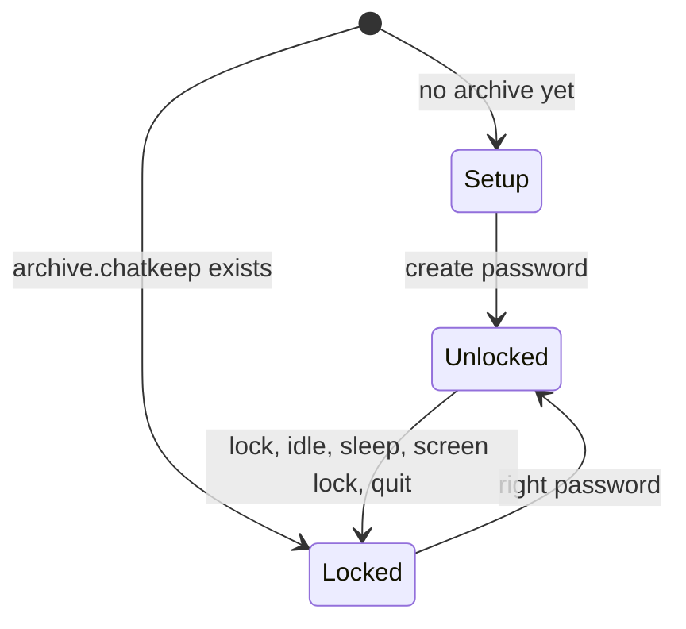
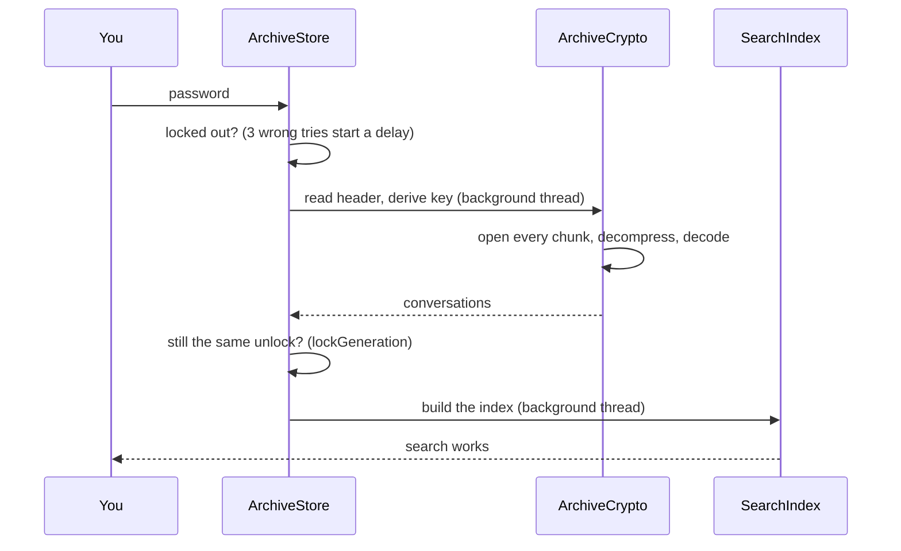
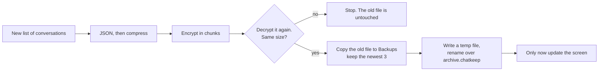
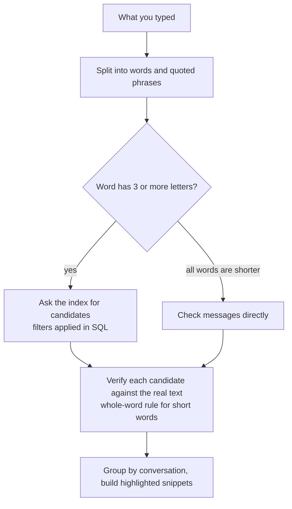

<p align="center">
  
</p>

<h1 align="center">ChatKeep: how it works inside</h1>

<p align="center">
  A guided tour of the code, for anyone who wants to understand it, check it, or change it.<br>
  No security background needed. New words are explained where they first appear.
</p>

---

## In one minute

ChatKeep turns the zip files that ChatGPT and Claude email you into one private, searchable library.

1. **Import.** It reads the export directly from the zip, one conversation at a time, so even a multi-gigabyte export (it is mostly images) never fills your memory.
2. **Store.** Every conversation goes into one file, `archive.chatkeep`, **encrypted** with a key made from your password.
3. **Search.** When you unlock, ChatKeep builds a search index **in memory only**. Nothing readable is ever written to disk.
4. **Check.** Leak Check scans everything for API keys and personal numbers you pasted by accident.

Two ideas shape the whole design: the data is **huge and untrusted** (so everything streams and everything has limits), and it is **private** (so it is only ever readable in memory, while unlocked).

## The big picture



## Watch an import

<p align="center">
  
</p>

<details>
<summary><b>The same steps in words</b></summary>

1. `ZipReader` finds the conversation files inside the zip and ignores the rest (images, HTML). Nothing is ever extracted to disk.
2. The file is decompressed a megabyte at a time, with a size limit and a checksum, so a "zip bomb" cannot fill your memory.
3. `JSONStreamSplitter` cuts the stream into single conversations by counting brackets. The whole file is never held in memory.
4. The importers turn ChatGPT's branching tree or Claude's list into one simple shape: title, dates, messages.
5. New chats are added, chats with more messages replace older copies, and chats you removed stay removed.
6. Everything is compressed, encrypted with AES-256-GCM in chunks, read back to verify, then saved in one atomic step.
7. A full-text index is built in memory so search is instant. It is never written to disk, and locking throws it away.

</details>

## Where everything lives

| File | What it does |
|---|---|
| `ZipReader.swift` | Reads a zip with random access and streams each entry through a 1 MB buffer. Checks sizes and checksums. Never writes anything to disk |
| `JSONStreamSplitter.swift` | Splits a huge JSON file into its top-level items without loading it, with no recursion |
| `ChatModels.swift` | The one shape every conversation is converted to, the import limits, and text cleaning |
| `Importers.swift` | Understands the ChatGPT and Claude export layouts (tolerantly) |
| `ExportReader.swift` | Takes a zip, folder or file, drives the steps above and writes a plain-language report |
| `ArchiveCrypto.swift` | The encrypted file format |
| `ArchiveStore.swift` | The unlocked state: create, unlock, merge imports, delete, backups, lockout, auto-lock |
| `SearchIndex.swift` | In-memory full-text search |
| `LeakScan.swift` | Finds secrets and personal data in the conversations |
| `BrowserModel.swift` | What the window shows: query, filters, results, open conversation, import progress |
| `LibraryViews.swift`, `ImportViews.swift`, `LeakViews.swift`, `AuthViews.swift`, `ChatKeepApp.swift` | The screens and the app entry point |
| Shared with other tools | `SecretRules`, `RedactionEngine`, `VaultCrypto`, `VaultReader`, `PasswordPolicy`, `Local` |

## Part 1: Reading an export

### Zip without extracting (`ZipReader`)

A zip file ends with a **directory** listing every file inside and where it starts. `ZipReader` reads that directory first (from the end of the file), then jumps straight to only the entries it wants. It reads only the conversation files, which are usually a small fraction of an export that is mostly images.

Each entry is **streamed**: compressed bytes are read 1 MB at a time, inflated through a 1 MB buffer, and handed on. While doing so it:

| Check | Why |
|---|---|
| Counts the output and stops at a limit (8 GB) | a "zip bomb" (600 MB of zeros that is a few hundred KB zipped) can't exhaust memory |
| Verifies the final size and **CRC checksum** | corruption is caught, not silently imported |
| Refuses password-protected entries with a clear message | and says to unzip them first |
| Uses file names only as labels | a name like `../../etc/x` can't write anywhere, because nothing is ever written |
| Supports ZIP64 | large exports use it |

A truncated download is detected and reported ("the zip file is cut off").

### One conversation at a time (`JSONStreamSplitter`)

`conversations.json` can be hundreds of megabytes. Loading it whole would use several times that in memory. The splitter reads it in chunks and **counts brackets and quotes** to know where each conversation starts and ends, handing each one over as soon as it is complete. Memory use is the size of the biggest single conversation, not the file.

It uses no recursion, only a counter, so 200,000 levels of nesting can't overflow the stack. A conversation over 64 MB is skipped and counted. A file cut off mid-way still delivers every complete conversation before the cut.

### Two formats, one shape (`Importers`)

Neither ChatGPT nor Claude officially documents its export, and both have changed over time, so the importers are deliberately **forgiving**: unknown fields are ignored, missing fields have fallbacks, and an item that can't be understood is skipped and counted instead of stopping the import.

Every conversation becomes:

```text
Conversation { id, source, title, created, updated, messages: [ { role, text, time, note } ] }
```

**ChatGPT stores a tree.** Edit a prompt or press "regenerate" and a new branch grows. You saw only one path through the tree, the one ending at `current_node`. So the importer starts there and follows `parent` links back to the root, with a "seen it already" check so a corrupted export with a loop can't spin forever. If `current_node` is missing, it takes the latest leaf instead.



The importer keeps `Hello → regenerated answer → thanks` and drops the abandoned branch. It also skips hidden system messages, the model's private reasoning, and saved-memory text, and notes images and files (`2 images`, `file: report.pdf`) rather than importing them.

**Claude stores a list**, with content in typed blocks (`text`, `thinking`, `tool_use`, `tool_result`). The importer keeps text and tool results, drops private "thinking", and includes the **text extracted from documents you attached**, because that text was sent to the model and belongs in search and in Leak Check.

Limits (`ImportLimits`) keep one monstrous conversation from exhausting memory:

| Limit | Value |
|---|---|
| Conversations per import | 500,000 |
| Messages in one conversation | 50,000 |
| Characters in one message | 500,000 (longer is cut, with a note) |
| Characters in one conversation | 8,000,000 |
| Size of one conversation as JSON | 64 MB |
| Nodes in a ChatGPT tree | 200,000 |

### Reading a zip, a folder, or a file (`ExportReader`)

It picks `conversations.json` (and ChatGPT's split `conversations-000.json`, `-001.json`, …) out of whatever you chose. For an unzipped folder it looks up to three levels deep and **never follows symlinks**, and opens files with a flag that refuses links. The result is an `ImportReport` in plain words: how many of each service, how many entries were skipped, which files were cut off, any warnings.

## Part 2: The encrypted archive (`ArchiveCrypto`)

### The file

```text
┌────────────────────────────────────────────────────────────────┐
│ CKA1\n                                    magic: "this is ours" │
│ {format, kdf, iterations, salt, cipher,    header, readable:    │
│  chunkSize, chunks, plainLength}\n         no secrets in it     │
├────────────────────────────────────────────────────────────────┤
│ [length][nonce · scrambled chunk 0 · tag]                       │
│ [length][nonce · scrambled chunk 1 · tag]                       │
│ …                                                               │
│ [length][nonce · scrambled last chunk · tag]                    │
└────────────────────────────────────────────────────────────────┘
```

The conversations are first converted to JSON and **compressed** (LZFSE), then split into **16 MB chunks**, and each chunk is encrypted with AES-256-GCM using a key derived from your password (PBKDF2, tuned to about half a second on your Mac, never under 600,000 rounds).

### Why chunks are tied together

Each chunk is sealed together with three things: **the exact header bytes**, **its position**, and **whether it is the last**. So:

| Attack | What happens |
|---|---|
| Flip any byte | that chunk's seal fails |
| Edit the header (lower the iteration count, change the length) | every chunk's seal fails |
| Swap or duplicate chunks | the position no longer matches |
| Drop the last chunk(s), or cut the file short | "last chunk" is wrong, or the count is short |
| Append anything | the file must end exactly after the last chunk |

The code also bounds the header (iterations between 100,000 and 20 million, chunk size 1 KB to 64 MB), so a tampered file can neither weaken nor hang the app. If the **first** chunk fails, that is what a wrong password looks like ("wrong password"); a later chunk failing means damage ("archive damaged").

## Part 3: The store (`ArchiveStore`)



### Unlocking



Heavy work (key derivation, decrypting, indexing) runs off the main thread so the window never freezes. A counter, `lockGeneration`, goes up on every lock; any slow job that finishes after you locked sees the number has changed and **throws its result away**, so a lock always wins.

### Importing and merging

When an import finishes reading, the store merges it with what you have:

| Situation | Result |
|---|---|
| New conversation | added |
| Same conversation, import has **more messages** | replaces the old copy |
| Same message count, later last-activity | replaces it |
| Older or identical | left alone |
| You removed it earlier (a "tombstone" is saved inside the archive) | skipped |

Conversation IDs are prefixed by service (`chatgpt:…`, `claude:…`) so they can never collide.

### Saving, every time



Verify-before-replace, atomic rename and "disk first, screen second" are the same ideas KeyVault uses. Changing the password re-encrypts everything under a fresh salt and **deletes the old backups** (they still open with the old password).

### Protections

| Protection | How |
|---|---|
| Lockout | 3 wrong passwords start a delay: 5 s, 10 s, 20 s… up to 5 minutes (saved, so quitting doesn't reset it) |
| Auto-lock | idle timer, sleep, screen lock, user switch, quit |
| One copy at a time | a file lock, so two copies can't overwrite each other |
| Big archive guard | a file over 4 GB is treated as damaged, not read |
| Permissions | folder `0700`, files `0600` |
| Hidden from screenshots, no crash dumps, debugger refused, hardened runtime | in `ChatKeepApp.swift` and `build.sh` |

## Part 4: Search (`SearchIndex`)

Search uses **SQLite's FTS5 with a trigram tokenizer**, which is built into macOS. A trigram index stores every 3-letter slice of every message (`api`, `pi_`, `i_k`, `_ke`, …), so typing *part* of a word finds it:

| You type | Finds |
|---|---|
| `api_k` | `api_key` |
| `cafe` | `Café` (accents and capitals ignored) |
| `日本語` | Japanese text, which has no spaces between words |
| `"quick brown"` | that phrase, in that order |
| `fox dog` | messages containing both |



Key points:

- **Your words are data, never syntax.** Each word or phrase is quoted and passed to SQLite as a bound parameter. `AND`, `NEAR`, `*`, `-`, quotes and even `'; DROP TABLE` are just text. Tests feed in 23 hostile queries.
- **Short words match whole words only.** `AI` should find the word "AI", not the letters inside "l**ai**t". (Chinese, Japanese and Korean have no word boundaries, so short terms there match as substrings.)
- **In memory only.** The database is `:memory:`, temporary storage is forced into memory, and a test confirms the temp and working folders are unchanged after building and searching. Locking drops the whole index.
- **Rebuilt after every change**, in the background, into a *new* index that replaces the old one, so searching never blocks. On an Apple M4, 200,000 messages index in about 2 seconds.

## Part 5: Leak Check (`LeakScan`)

For each message, `LeakScanner`:

1. Runs `SecretRules` (the same detector as LeakGuard) for keys, tokens and private keys.
2. Runs `RedactionEngine` (the same detector as Redact) for card numbers, IBANs and SSNs, emails and IP addresses, **but only if a cheap check says the message could contain one**: at least 8 digits for cards and IBANs, an `@` for emails, a dot and 4 digits for IPs. Most messages have none, so most skip the slow part.
3. Searches for your **exact KeyVault keys** (if you chose that), tagging matches with the entry's name.

A finding stores a **masked preview** (`sk-p••••••••Ab3x`) and a short **fingerprint** (a hash), never the secret. The fingerprint groups the same secret across messages and chats ("seen 3 times in 2 chats").

## The screens

- `BrowserModel` holds the search box, filters (service, who said it, when), the results and the open conversation. Typing waits 0.22 seconds before searching, and locking wipes all of it.
- Transcripts are drawn as **plain text only**: no Markdown, links, HTML or images are ever interpreted from a conversation, and direction-override characters are stripped. Messages over 20,000 characters show a "Show all" button.
- The transcript is a lazy list: only the messages on screen are built, so a 50,000-message conversation stays smooth.

## Tests

`./build.sh` runs **210** tests before building.

| Suite | Count | What it covers |
|---|---|---|
| `tests/main.swift` | 177 | JSON splitting (including 300 random documents), real zips (stored, deflated, ZIP64, comments, traversal names, encrypted, truncated, corrupted, a 600 MB bomb), both importers, the archive format under every tamper, search (including hostile queries and 80,000 messages), Leak Check, and the store in real folders |
| `tests/integration/main.swift` | 33 | the **real** app model in a throwaway folder: import, browse, search, filters, Leak Check, delete, lock, unlock, and what is on disk |

Fake secrets in tests are built at runtime so the repository itself never contains something that looks like a real key.

```bash
swiftc -O Sources/SecretRules.swift Sources/RedactionEngine.swift Sources/VaultCrypto.swift Sources/VaultReader.swift \
  Sources/ZipReader.swift Sources/JSONStreamSplitter.swift Sources/ChatModels.swift Sources/Importers.swift \
  Sources/ExportReader.swift Sources/ArchiveCrypto.swift Sources/SearchIndex.swift Sources/LeakScan.swift \
  Sources/ArchiveStore.swift tests/main.swift -o /tmp/ck-tests && /tmp/ck-tests
```

## Changing things safely

<details>
<summary><b>Support another service's export (say, Gemini)</b></summary>

1. In `Importers.swift`, add a `ChatSource` case (`ChatModels.swift`) and a new importer that turns one item into a `Conversation`. Be forgiving: ignore unknown fields, give everything a fallback.
2. Teach `ChatImporters.source(of:)` how to recognise that format from its keys.
3. Make sure its text goes through `TextCleaning.clean` and the `ImportLimits` caps.
4. Add fixtures to `tests/main.swift`: a normal conversation, a messy one (wrong types, missing fields), and an empty one that must be skipped.
5. Add the service to the filter menu in `LibraryViews.swift` (it builds from `ChatSource.allCases`).

**Test against a real export if you can**; the shapes here come from third-party descriptions.

</details>

<details>
<summary><b>Change the archive format</b></summary>

Don't edit `format = "chatkeep-1"` in place: existing archives would stop opening. Add a new version string, keep reading the old one, and write the new one. Add tests that open an archive made by the old version.

</details>

<details>
<summary><b>Add a new Leak Check category</b></summary>

Add it to `LeakKind` and `LeakOptions`, detect it in `LeakScanner.scan` **behind a cheap pre-check** (so ordinary messages skip it), add a toggle in `LeakViews.swift`, and test both a hit and a near-miss. Run the 4,000-clean-conversations test to check speed.

</details>

## Gotchas

- **Never write a decrypted message to disk**, not even temporarily. That includes SQLite: keep it `:memory:` with `temp_store=MEMORY`.
- **Don't load whole files.** Anything that reads an export must stream and respect the limits.
- **The import formats are unverified against real exports.** Treat a surprising real-world file as a bug in the importer, not in the file.
- **Memory:** an unlocked archive uses about 7 times its text size. That is a design trade-off for instant search, not a leak.
- **Shared copies.** `SecretRules`, `RedactionEngine`, `VaultCrypto`, `VaultReader`, `PasswordPolicy` and `Local` are copies. Edit the originals, copy, run `tools/check-shared.sh`.

## Glossary

| Word | Plain meaning |
|---|---|
| **Export** | The zip a service emails you with all your data |
| **Stream** | Read a little at a time instead of all at once |
| **Zip bomb** | A tiny zip that expands to something enormous, meant to crash programs |
| **CRC** | A checksum used by zip files to detect corruption |
| **Chunk** | A piece of the archive, encrypted separately |
| **Tombstone** | A saved note that you removed something, so re-importing won't bring it back |
| **Trigram** | A 3-letter slice of text, the unit the search index stores |
| **FTS5** | SQLite's full-text search feature |
| **In-memory** | Held in RAM only, gone when locked or quit |
| **Fingerprint** | A short hash that identifies a secret without revealing it |

---

<p align="center">
  <sub>Part of <a href="../README.md">ai-tools</a> · back to <a href="README.md">ChatKeep</a> · licensed under the <a href="../LICENSE">GNU AGPL v3</a></sub>
</p>
