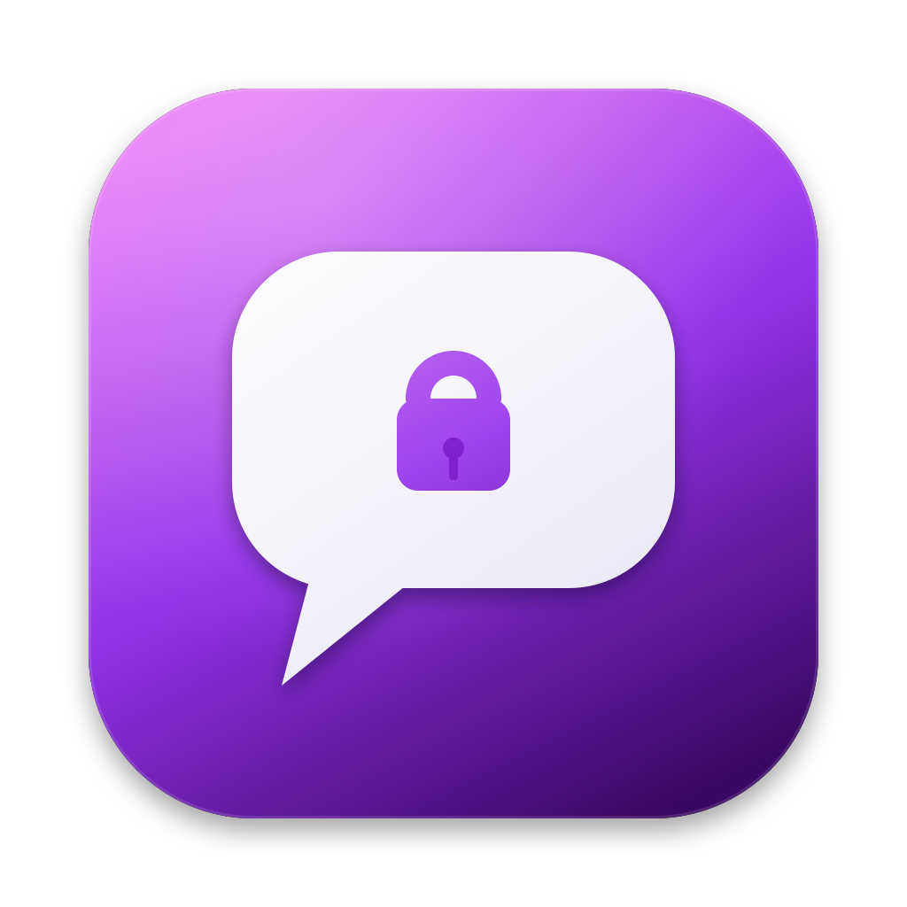

<p align="center">
  
</p>

<h1 align="center">ChatKeep</h1>

<p align="center">
  Your ChatGPT and Claude history, searchable in one place, encrypted, and checked for secrets you pasted by accident.<br>
  A native Mac app. Nothing is uploaded; there is no network code at all.
</p>

---

## What it does

- **Imports your exports** from ChatGPT and Claude: the zip file as it arrives by email, an unzipped folder, or a single JSON file
- **Searches everything at once.** Type part of a word (`api_k` finds `api_key`), a phrase in quotes, or Japanese text. It ignores capitals and accents (`cafe` finds `Café`), and results show highlighted excerpts. Filter by service, by who said it, and by date
- **Encrypts your archive** with AES-256-GCM, using a key made from your password. Titles, messages and file names never appear on disk in readable form
- **Leak Check:** finds API keys, passwords, card numbers, bank accounts and ID numbers you pasted into chats, plus the *exact* keys stored in your [KeyVault](../keyvault/), even ones in an unrecognisable format
- **Keeps history you can lose.** Providers can delete chats or change retention. Your archive is yours
- Locks automatically after inactivity, on sleep and when the screen locks; keeps 3 encrypted backups; lets you remove a conversation for good

## Requirements

| | |
|---|---|
| **macOS** | 14 Sonoma or later (Apple Silicon or Intel) |
| **Tools** | Apple's free Command Line Tools. Full Xcode is **not** needed |

## Setup

```bash
xcode-select --install
```

```bash
git clone https://github.com/tanmayhc7/ai-tools.git
```

```bash
cd ai-tools/chatkeep && ./build.sh
```

```bash
open build/ChatKeep.app
```

To install it: `cp -R build/ChatKeep.app /Applications/`

The build runs 210 self-tests first; every line should say `PASS`.

## Getting your data out of ChatGPT and Claude

| Service | How |
|---|---|
| **ChatGPT** | Settings → Data controls → **Export data**. You'll get an email with a download link to a zip file |
| **Claude** | Settings → Privacy → **Export data**. You'll get an email with a download link to a zip file |

Keep the zip as it is. You don't need to unzip it, and ChatKeep reads only the conversation files inside it, even when the zip is several gigabytes of images.

> ⚠️ **Delete the export after importing.** The zip holds your whole history in plain, readable form. Once ChatKeep has it, move the zip to the Trash and empty it.

## Using it

1. **Create your archive:** choose a password. It can't be recovered; there is no reset.
2. **Import:** drop the zip on the window, or press <kbd>⌘</kbd><kbd>I</kbd>. Import again whenever you download a fresh export: conversations you already have are updated with new messages, never duplicated, and an older export never overwrites newer history.
3. **Search:** just start typing. Click a result to jump to that message, highlighted.
4. **Leak Check** (<kbd>⇧</kbd><kbd>⌘</kbd><kbd>L</kbd>): pick what to look for and scan. To also find your own KeyVault keys, tick the box and enter your KeyVault password.

| Action | How |
|---|---|
| Import an export | **Import** in the toolbar, <kbd>⌘</kbd><kbd>I</kbd>, or drop it on the window |
| Lock now | 🔒 in the toolbar, or <kbd>⌘</kbd><kbd>L</kbd> |
| Copy a message | Right-click it → **Copy Message** |
| Copy a whole conversation | ⋯ menu in the conversation → **Copy Conversation as Text** |
| Remove a conversation | ⋯ menu → **Remove from Archive…**. It stays removed even if you import the same export again |
| Auto-lock time, change password | ⚙️ menu |

### Where your data lives

```
~/Library/Application Support/ChatKeep/
├── archive.chatkeep    ← your encrypted archive
└── Backups/            ← the 3 newest versions, also encrypted
```

## What it reads from an export, and what it doesn't

| Imported | Not imported |
|---|---|
| Conversation titles, dates, the messages you sent and received, code blocks, text extracted from documents you attached to Claude chats, voice transcripts | Images, audio and file contents (a note like "2 images" or "file: report.pdf" is kept), Claude artifacts and projects, ChatGPT's hidden reasoning and saved memory text, other things in the zip (profile, feedback, HTML copy) |

For ChatGPT, which stores edits and "regenerate" as a tree, ChatKeep keeps the conversation as you last saw it, not the abandoned branches.

> **Honest note on formats.** Neither ChatGPT nor Claude publishes an official description of its export, and both have changed over time. ChatKeep is built to be forgiving: it accepts both known layouts for each service (including ChatGPT exports split across several files), ignores fields it doesn't know, and skips anything it can't understand rather than stopping. It was tested against files built to match those layouts and against hostile and broken files, but **not against your real export**. If an import looks wrong, please open an issue.

## Security design

| Part | How it works |
|---|---|
| Password → key | **PBKDF2-HMAC-SHA256**, tuned to about 0.5 s on your Mac (millions of iterations, never fewer than 600,000), with a 16-byte random salt. The password is Unicode-normalised first |
| Encryption | **AES-256-GCM** in chunks. Each chunk is authenticated together with the exact file header, its position and whether it's the last, so editing, reordering, duplicating, dropping or appending chunks, or cutting the file short, all make unlocking fail |
| Wrong password | Nothing is stored to check it against. A wrong password simply fails authentication, and 3 failures start a lockout (5 s, doubling to 5 min) |
| Saving | Every save is decrypted again and checked before it replaces the old file, written atomically, and preceded by an encrypted backup. A crash or power cut can't leave a half-written archive |
| Search | An in-memory index only. The database is `:memory:`, temporary storage is forced to memory, and nothing is ever written to disk. Your words reach SQLite as data, never as search syntax or SQL |
| Network | None. The app contains no networking code |
| Libraries | Apple's CryptoKit, SQLite and compression only. No third-party code |

### Attacks tested and how they're handled

ChatKeep reads files that arrive from outside and are far bigger than the average document, so the importer was attacked as hard as the encryption.

| Attack | Result |
|---|---|
| **Zip bomb** (600 MB of zeros that is a few hundred KB zipped) | Streamed through a 1 MB buffer and stopped at the limit; memory never grows |
| Zip with `../../` path tricks in its file names | Names are only labels: nothing is ever extracted or written to disk |
| Password-protected, truncated, corrupted or fake zips | Clear message for each; a flipped byte is caught by decompression or the checksum, and what was readable before the damage is still imported, with a warning |
| JSON nested 200,000 levels deep | Read without recursion, so no stack overflow |
| A single conversation or message of absurd size | Skipped and counted, or capped, instead of exhausting memory |
| Truncated, junk or empty JSON | Complete conversations before the cut are kept; the rest is reported |
| Symlinks dropped into an unzipped export | Never followed |
| Tampering with the archive: any flipped byte, header edits, lowered iteration count, dropped, swapped or duplicated chunks, trailing bytes | Unlocking is refused every time |
| Hostile search queries: operators (`AND`, `NEAR`, `*`, `-`), quotes, SQL, NUL characters, a 100 KB query | Treated as plain text: no crash, no error, no special meaning |
| Titles or messages using direction-override and invisible characters to disguise text | Stripped before display. Transcripts are drawn as plain text, never as Markdown, links, HTML or images |
| Locking while an import is running | The archive is left either unchanged or fully updated, never half-written, and nothing stays open |
| Plaintext left behind | Titles, messages and keys were searched for inside the archive file and aren't there. The archive folder holds only the archive, its backups and a lock file, and building the search index writes no files to the temp or working folder |
| Guessing the password | Escalating lockout. Guessing through the KeyVault check shares KeyVault's own lockout counter |
| Debuggers, crash dumps, code injection, screen capture | Hardened runtime, debugger attach refused, core dumps off, every window hidden from screenshots and recordings |
| Clipboard | Copied text stays on this Mac (no sync to your other devices) and is hidden from clipboard managers |

Found and fixed while building it: a leak scan that took **33 seconds** for 200,000 messages (now 1.4 s; the same fix speeds up LeakGuard, Redact and ContextPack), short searches like `AI` matching inside "l**ai**t" (short words now match whole words only), and a flaky code-signing step in cloud-synced folders such as an iCloud Desktop (all build scripts now retry).

### Speed

A 109 MB export (20,000 conversations, 200,000 messages) on an Apple M4: imported, encrypted and saved in 6.6 s; unlocked in 0.8 s; searchable 2.3 s later; each query about a quarter of a second; Leak Check in 1.4 s. Memory use is roughly 7× the size of your text while the archive is unlocked.

### What it can't protect against

- **Malware already running as you, or as root.** It could log your keystrokes, read the window, or wait for you to unlock. No app can defend against a compromised account.
- **The export you downloaded.** It's plain text. Delete it once imported.
- **A weak password.** Someone with a copy of `archive.chatkeep` can guess offline as fast as their hardware allows. Use four or more random words.
- **Secrets in memory while unlocked.** Swift can't reliably wipe strings from memory. Locking drops them, and macOS encrypts swap.
- **What was already shared.** Leak Check can tell you a key is in a chat, but it can't recall it. Rotate any real key it finds.

## Troubleshooting

| Problem | Fix |
|---|---|
| "No conversation files found" | The zip should contain `conversations.json` (ChatGPT may split it into `conversations-000.json`, `-001.json`, …). If you unzipped it, choose the folder instead |
| "The zip file is cut off" | The download didn't finish. Download it again |
| "password-protected" | Unzip it with the password first, then import the folder |
| Fewer conversations than expected | The import report lists what was skipped (empty chats, unrecognised entries, files cut off) |
| A conversation looks incomplete | ChatGPT edits and regenerations create branches; ChatKeep shows the branch you last viewed |
| "Index is building" | Searching is available a few seconds after unlocking a large archive |
| "ChatKeep is already open" | Only one copy can run at a time. Use the open window |
| Forgot the password | It can't be recovered. Delete `~/Library/Application Support/ChatKeep` and import your exports again |
| Screenshots of the app are blank | Intentional: windows are hidden from screen capture |

## Project layout

```
chatkeep/
├── build.sh                    Builds the app and runs all tests
├── Sources/
│   ├── ZipReader.swift          Streaming, defensive zip reader
│   ├── JSONStreamSplitter.swift Splits huge JSON files without loading them whole
│   ├── ChatModels.swift         Conversations, messages, text cleaning
│   ├── Importers.swift          ChatGPT and Claude conversation parsers (tolerant)
│   ├── ExportReader.swift       Reads a zip, folder or file and reports what happened
│   ├── ArchiveCrypto.swift      The encrypted file format
│   ├── ArchiveStore.swift       Create, unlock, import-merge, delete, backups, auto-lock
│   ├── SearchIndex.swift        In-memory full-text search
│   ├── LeakScan.swift           Secret and personal-data scan
│   ├── BrowserModel.swift       Search box, filters and selection
│   ├── *Views.swift, ChatKeepApp.swift   Screens and app entry point
│   └── (shared with the other tools: SecretRules, RedactionEngine, VaultCrypto, VaultReader, PasswordPolicy, Local)
├── tests/main.swift             177 engine tests
├── tests/integration/main.swift 33 tests of the real app model
└── tools/make_icon.swift        Draws the app icon
```
