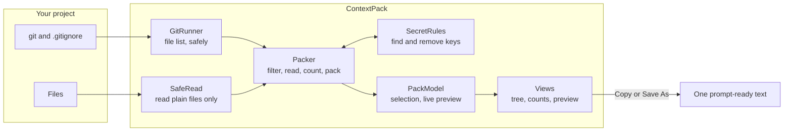
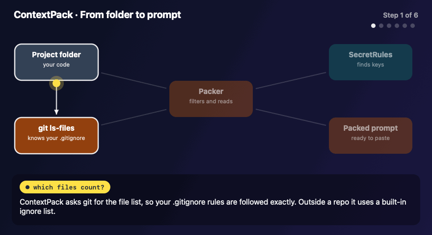
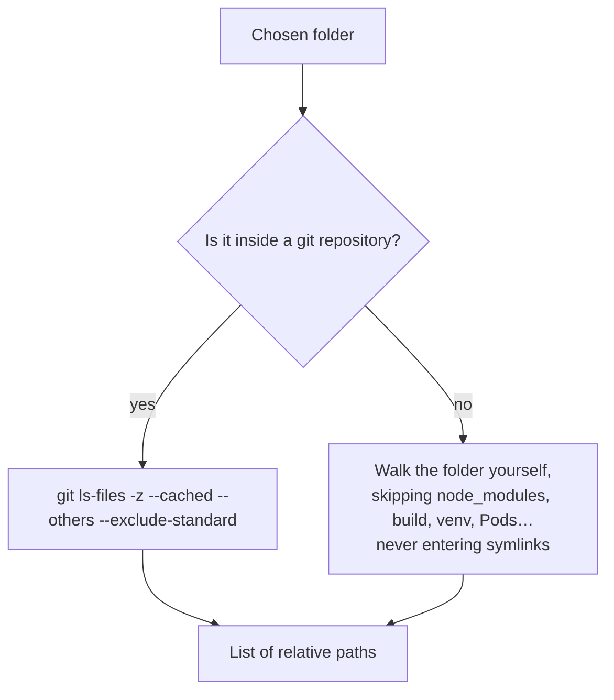
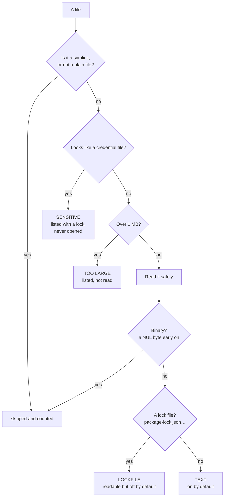

<p align="center">
  
</p>

<h1 align="center">ContextPack: how it works inside</h1>

<p align="center">
  A guided tour of the code, for anyone who wants to understand it, check it, or change it.<br>
  No security background needed. New words are explained where they first appear.
</p>

---

## In one minute

ContextPack turns a code project into one block of text you can paste into an AI.

1. **It asks git which files belong.** So your `.gitignore` is followed exactly.
2. **It reads the safe ones and lists the dangerous ones without opening them.** `.env` files, private keys and cloud credentials are shown with a lock and never read.
3. **You tick what you want.** It counts tokens as you go and tells you which AI context sizes it fits.
4. **When you copy, secrets are swapped for `[REDACTED …]`** and every file is wrapped so its own content can't break the format.

Because you open folders you may not have written, ContextPack treats every file as potentially hostile: it never follows links out of the folder, never lets a file hang the app, and runs git with its program-launching features off.

## The big picture



## Watch a pack

<p align="center">
  
</p>

<details>
<summary><b>The same steps in words</b></summary>

1. ContextPack asks git for the file list, so your `.gitignore` rules are followed exactly. Outside a repo it uses a built-in ignore list.
2. The list arrives null-separated, so file names with spaces, quotes or even line breaks cannot confuse it.
3. Credential files (`.env`, `*.pem`, SSH keys…) are listed with a lock but never opened. Binaries, symlinks and files over 1 MB are skipped.
4. The remaining text files are read once. Each is opened in a way that refuses anything except a plain file.
5. Every file is checked for secrets and its tokens are estimated. That is what the shield icon and the counts in the list show.
6. When you copy, secrets are replaced and each file is wrapped in XML tags or Markdown fences its own content cannot break.

</details>

## Where everything lives

| File | What it does |
|---|---|
| `Packer.swift` | **The engine, with no screen code.** Lists files, decides what to read, estimates tokens, builds the output. Fully tested |
| `GitRunner.swift` | Runs `git` safely against untrusted folders. Shared with LeakGuard |
| `SafeRead.swift` | Reads a file only if it is a plain file, never following links and never blocking. Shared with LeakGuard |
| `SecretRules.swift` | The secret patterns (the same detector LeakGuard, Redact and ChatKeep use) |
| `ContextPackApp.swift` | App entry point, and `PackModel`: opening a folder, tick boxes, live preview, copy and save |
| `ContextPackViews.swift` | The file tree, the token panel, the preview |
| `Local.swift` | A small stand-in for a SwiftUI feature that needs full Xcode |

## Part 1: Which files? (`Packer.listFiles`)



The git command means: tracked files, plus new untracked ones, minus anything ignored by **any** `.gitignore`, nested ones included. Asking git beats re-implementing ignore rules, which are surprisingly intricate. `-z` makes git separate names with a NUL byte rather than a newline, so no file name, however odd, can be misread.

## Part 2: What to do with each file (`Packer.load`)

Each file lands in exactly one of four kinds:



### How "looks like a credential file" is decided (`isSensitive`)

| Rule | Examples |
|---|---|
| Any `.env` file, **except** examples | `.env`, `.env.local`, `prod.env` are sensitive; `.env.example`, `.env.sample`, `.env.template` are fine |
| Known credential names | `.npmrc`, `.netrc`, `id_rsa`, `credentials`, `terraform.tfstate`, `secrets.yaml`, `google-services.json`… |
| Key and certificate extensions | `.pem`, `.key`, `.p12`, `.pfx`, `.jks`, `.keystore`, `.tfvars`… |
| JSON that is named like credentials | `service-account.json`, `client_secret_….json` |
| Anything inside | `.ssh/`, `.aws/`, `.gnupg/`, `.docker/`, `.kube/` |

A sensitive file is **listed but never read into memory**, so even a bug later in the pipeline couldn't leak its contents. A test checks that `.env` content never reaches memory.

### The safety rules in `load`

| Rule | Why |
|---|---|
| Never follow symlinks | a link out of the project could pull in your whole disk |
| Read through `SafeRead` | opens once and checks the open handle, so a file swapped for a pipe mid-load can't hang the app |
| 1 MB per file, 20,000 files, 150 MB in total | bounds memory on huge projects |
| Skipped binaries and links are counted | so the panel can say what was left out |

## Part 3: Counting tokens

AIs read **tokens**, roughly word-pieces, not characters, and each has a limit. `estimateTokens` uses a simple rule of thumb: about 4 ASCII characters per token (typical for code and English), and one token per non-ASCII character (a fair guess for Chinese, Japanese, Korean and many other scripts). It is an estimate. Exact counts differ a little by model.

The panel compares your total against 32K, 128K, 200K and 1M and ticks the ones it fits.

## Part 4: Building the output (`Packer.pack`)

Two formats, chosen with a switch: **XML tags** (works well with Claude) or **Markdown**.

XML tags:

```text
<project name="my-app">
<file_tree>
├── src/
│   └── main.py
└── README.md
</file_tree>

<file path="src/main.py">
API_KEY = "[REDACTED OpenAI API key]"
…
</file>
</project>
```

Markdown:

````text
# Project: my-app

## File tree
(the same tree, in a code block)

## Files

### `src/main.py`

```python
API_KEY = "[REDACTED OpenAI API key]"
…
```
````

Steps for each selected file: replace secrets with `[REDACTED <kind>]`, then wrap it. The wrapping defends against files that try to break out:

- **XML:** a file containing the text `</file>` would end its block early, so inside the body it is rewritten to `<\/file>`. File paths in attributes are XML-escaped too.
- **Markdown:** a file containing a triple-backtick would end its code fence. The fence is made **longer than the longest run of backticks in the file**.
- Credential files are never in the selection, even if you ticked them: `pack` only writes files whose kind is text or lockfile.

The tree is drawn by `renderTree`, folders first, then files, naturally sorted.

## Part 5: The app around it (`PackModel`)

- **Tick boxes with three states.** A folder is on, off or mixed. `descendants` is a precomputed map from each folder to every selectable file under it, so ticking a folder with 5,000 files is instant.
- **Live preview.** When the selection or format changes, packing reruns on a background thread after a 0.25-second pause, so the window never freezes.
- **Defaults.** Text files start ticked, lock files start unticked (they're mostly noise), sensitive and too-large files can't be ticked.
- **Windows** aren't hidden from screen capture in this tool: your code isn't a secret the way keys are. Credential *contents* are never loaded at all.

## Tests

`./build.sh` runs all **54** tests (`tests/main.swift`) before building.

| Group | What it covers |
|---|---|
| Credential rules | 16 paths that must be sensitive, 8 that must be allowed |
| Output format | token estimates, the tree, language tags, fence length, XML escaping, a file containing `</file>` |
| A plain folder | `.env` not read, `node_modules` skipped, symlink out of the folder not followed, binaries, a huge file, odd file names |
| A git repository | tracked plus untracked files, `.gitignore` and nested `.gitignore`, a subfolder of a repo, and **a booby-trapped repo that must not run anything** |

```bash
swiftc -O Sources/SecretRules.swift Sources/GitRunner.swift Sources/SafeRead.swift Sources/Packer.swift tests/main.swift -o /tmp/cp-tests && /tmp/cp-tests
```

## Changing things safely

<details>
<summary><b>Treat another kind of file as a credential</b></summary>

Add it to the right list at the top of `isSensitive` in `Packer.swift` (`sensitiveNames`, `sensitiveExtensions`, or `sensitiveDirs`). Then add a line to the "must be sensitive" list in `tests/main.swift`, and an "allowed" look-alike so you don't over-block.

</details>

<details>
<summary><b>Add a third output format (say, plain text)</b></summary>

1. Add a case to `Packer.Format` (the picker in the UI builds itself from `allCases`).
2. Add a `case` to the `switch format` in `Packer.pack`. Whatever you wrap each file in, make sure **file content cannot close the wrapper** (see the XML and Markdown cases).
3. Add tests for hostile content: a file that contains your closing marker.

</details>

<details>
<summary><b>Change the limits</b></summary>

`maxFileBytes`, `maxFiles` and `maxTotalBytes` at the top of `Packer`. The panel's "Very large project" note is tied to them.

</details>

## Gotchas

- **Never read a sensitive file "just to count tokens".** Its tokens and secret count are zero by design.
- **Never call git directly.** Always go through `GitRunner`; it switches off every setting that can launch a program.
- **Don't trust a file name.** Names may contain spaces, quotes, accents and line breaks. Paths are kept as strings and escaped where they are written.
- **Shared copies.** `SecretRules.swift`, `GitRunner.swift` and `SafeRead.swift` are used by other tools. Edit the original (in `leakguard/`), copy, run `tools/check-shared.sh`.

## Glossary

| Word | Plain meaning |
|---|---|
| **Token** | The unit an AI reads: roughly a word-piece, about 4 characters |
| **Context window** | How many tokens an AI can read in one go |
| **`.gitignore`** | A list of files git should leave out |
| **Symlink** | A shortcut file that points somewhere else |
| **Lock file** | A file like `package-lock.json` that records exact dependency versions |
| **Fence** | The triple-backtick lines that mark a code block in Markdown |
| **NUL separator** | An invisible zero byte used to separate names that may contain any other character |

---

<p align="center">
  <sub>Part of <a href="../README.md">ai-tools</a> · back to <a href="README.md">ContextPack</a> · licensed under the <a href="../LICENSE">GNU AGPL v3</a></sub>
</p>
