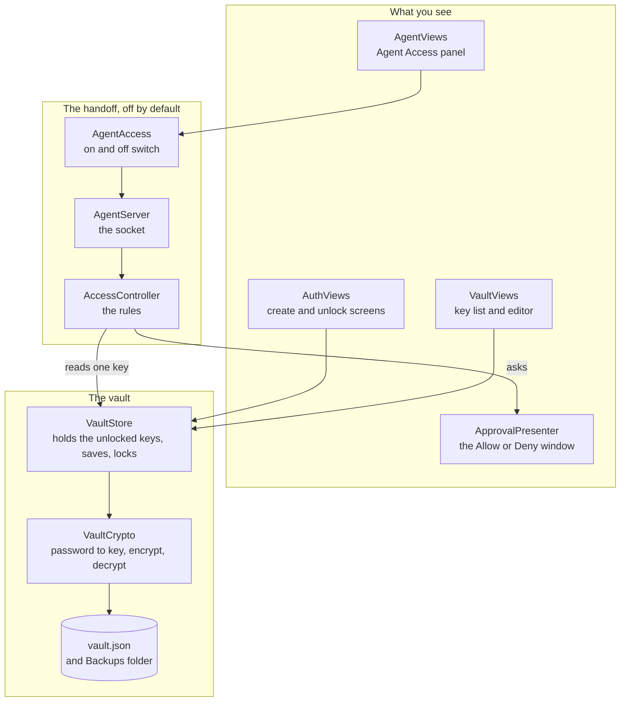
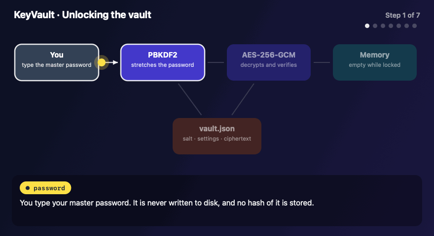
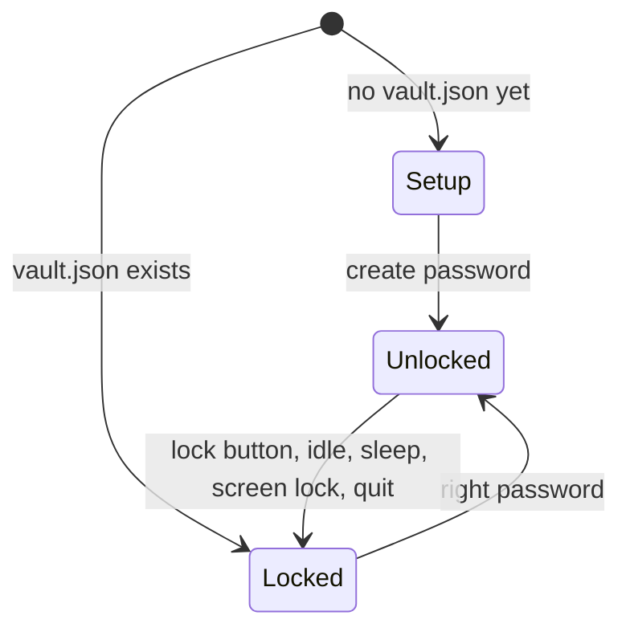
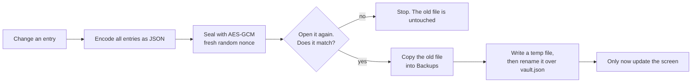
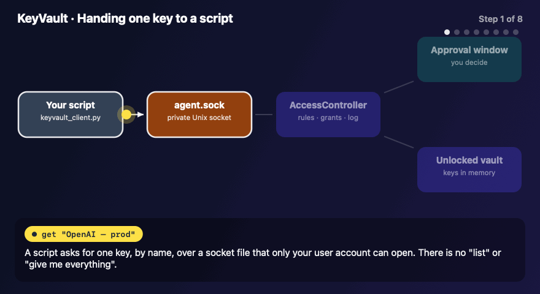
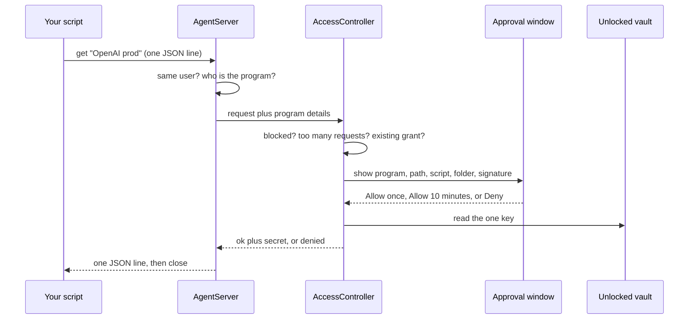

<p align="center">
  
</p>

<h1 align="center">KeyVault: how it works inside</h1>

<p align="center">
  A guided tour of the code, for anyone who wants to understand it, check it, or change it.<br>
  No security background needed. New words are explained where they first appear.
</p>

---

## In one minute

KeyVault is a locked box for your API keys.

1. **One file holds everything.** `vault.json` contains all your keys, scrambled (encrypted). Without your master password it is just noise.
2. **The password is turned into a key.** When you type it, a slow maths routine stretches it into the real unlocking key. Slow on purpose: it makes password guessing expensive.
3. **Keys only exist readable while unlocked, and only in memory.** Lock the vault and they vanish.
4. **Optionally, scripts can ask for a key.** KeyVault shows you who is asking and only hands over the key if you click Allow.

Everything below is a closer look at those four ideas.

## The big picture



## Watch it unlock

<p align="center">
  
</p>

<details>
<summary><b>The same steps in words</b></summary>

1. You type your master password. It is never written to disk, and no hash of it is stored.
2. The random **salt** and the iteration count are read from the top of `vault.json`. They are not secret.
3. PBKDF2-HMAC-SHA256 repeats its hash hundreds of thousands to millions of times (about half a second of work), so every guess is slow for an attacker.
4. Out comes a 256-bit key. The same password and salt always give the same key.
5. The encrypted payload is read. The header (format, salt, iterations) is checked along with it, so editing the file breaks decryption.
6. Right password and untouched file: the entries decrypt into memory. A wrong password simply fails this check.
7. Locking (or sleep, or idle time) drops the key and the entries. Decrypted data never touches the disk.

</details>

## Where everything lives

| File | What it does | Read it when you want to know… |
|---|---|---|
| `KeyVaultApp.swift` | App entry point. Turns off crash dumps, refuses debuggers, allows only one copy to run, hides windows from screenshots | how the app protects itself |
| `VaultCrypto.swift` | Password → key (PBKDF2), encrypt and decrypt (AES-GCM). About 130 lines and the heart of the security | how the encryption works |
| `VaultStore.swift` | The unlocked state: the list of keys, saving, backups, locking, the unlock lockout, the clipboard | what happens on every save and lock |
| `PasswordPolicy.swift` | Rejects weak master passwords | why `password123` is refused |
| `AuthViews.swift` | Create-vault and unlock screens | the first screens you see |
| `VaultViews.swift` | The key list, the editor, settings menu | everyday UI |
| `AgentProtocol.swift` | The message format scripts use, and cleaning up text before showing it | what a request looks like |
| `ProcessInspector.swift` | Works out which program is on the other end of a connection | what the Allow window shows |
| `AccessController.swift` | The brain of the handoff: approvals, time-limited grants, blocking, the log | the rules |
| `AgentServer.swift` | The private socket that scripts connect to | how requests arrive |
| `AgentAccess.swift` | The on/off switch, and the link between the handoff and the real vault | how it is wired up |
| `ApprovalPresenter.swift` | The Allow or Deny window | what you click |
| `AgentViews.swift` | The Agent Access panel (switch, active access, activity log) | the settings panel |
| `Foreground.swift`, `Logo.swift`, `Local.swift` | Small helpers. `Local` stands in for a SwiftUI feature that needs full Xcode | little things |

Also here: `agent/keyvault_client.py` (the Python client), `tests/` (everything is tested), `build.sh`.

## Part 1: The vault

### The three states



`VaultStore.Phase` is exactly these three values. The window shows a different screen for each.

### What is inside `vault.json`

```json
{
  "format": "keyvault-1",
  "kdf": "PBKDF2-HMAC-SHA256",
  "iterations": 3500000,
  "salt": "…16 random bytes, base64…",
  "cipher": "AES-256-GCM",
  "payload": "…nonce + scrambled entries + tag, base64…"
}
```

Only the first five lines are readable. Your key names, services, notes and the keys themselves are all inside `payload`.

### Turning a password into a key

`VaultCrypto.deriveKey` runs **PBKDF2-HMAC-SHA256**:

- **Salt:** random bytes stored in the file. They make everyone's key different even if two people pick the same password, and they defeat pre-computed guess tables.
- **Iterations:** how many times the hash is repeated. On first use the app measures your Mac and picks a count that takes about half a second (never fewer than 600,000). A vault made with a weaker count is quietly upgraded the next time you unlock it (`upgradeThreshold`).
- **Normalisation:** the password is Unicode-normalised first, so `é` typed as one character or as `e` plus an accent gives the same key on any keyboard.

### Locking the data: AES-256-GCM

AES-GCM does two jobs at once: it **scrambles** the data and it **seals** it, so any change, even one flipped bit, makes decryption fail loudly instead of returning garbage.

The sealing also covers the header. The text `keyvault-1|PBKDF2-HMAC-SHA256|<iterations>|<salt>|AES-256-GCM` is fed in as *associated data*, so an attacker who edits the iteration count to make guessing cheaper just makes the file un-openable. The code also rejects iteration counts below 100,000 or above 20 million, so a tampered file can neither weaken nor hang the app.

There is no stored "password check". A wrong password simply fails the seal, which is also what stops anyone from checking guesses without doing the full slow work.

### Every save, step by step



Three details matter:

- **Verify before replacing** (`VaultStore.write`): the new file is decrypted again and compared before it replaces anything.
- **Atomic write:** the data goes to a temporary file that is *renamed* into place. A crash or power cut leaves either the old vault or the new one, never half of each.
- **Disk first, screen second** (`commit`): the list you see is only updated after the save succeeded, so the screen never shows something that isn't on disk.

KeyVault keeps the 10 newest encrypted backups. Changing the master password deletes them (they still open with the old password) and makes a fresh one.

### Locking and the lockout

The vault locks when you press Lock, when you are idle (`autoLockMinutes`; a 10-second timer checks), when the Mac sleeps, when the screen locks, when the user session switches, and on quit. Locking sets the key to nothing and empties the entries. A counter, `lockGeneration`, makes sure an unlock that was still working when you locked is thrown away.

Wrong passwords: after 3 in a row the app refuses attempts for 5 seconds, then 10, 20, and so on up to 5 minutes. The counters are saved so quitting doesn't reset them.

### Other protections, in `VaultStore` and `KeyVaultApp`

| Protection | How |
|---|---|
| One copy at a time | An exclusive file lock (`flock`) on `.lock`, so two copies can't overwrite each other's saves |
| No leaks through the clipboard | Copied keys stay on this Mac, are marked so clipboard managers skip them, and are cleared after 30 seconds, on lock and on quit |
| No giant files | A vault file over 32 MB is refused instead of read |
| Safe file permissions | The folder is `0700`, files are `0600` |
| Hidden from screenshots | Every window, including sheets, is excluded from screen capture |
| No crash dumps, no debuggers | `RLIMIT_CORE` set to 0, and `PT_DENY_ATTACH` called at launch |
| No code injection | Built with the hardened runtime and no special entitlements |

## Part 2: The handoff to scripts and agents

This is **off by default**. Until you switch it on in ⚙️ → Agent Access, no socket exists.

### The problem it solves

A script that needs an API key could ask you to type your master password. But a script has none of KeyVault's protections, so malware could read the password as you type it. Instead, the *app* keeps the password, and the script asks for **one named key**. You approve each request in KeyVault's own window.

### Watch a request

<p align="center">
  
</p>

<details>
<summary><b>The same steps in words</b></summary>

1. A script asks for one key, by name, over a socket file that only your user account can open. There is no "list" or "give me everything".
2. `AgentServer` checks the caller is you, then looks up the program: its path, script, folder and code signature.
3. `AccessController` checks rate limits and blocks, and whether this exact process already has a time-limited grant.
4. No grant, so a window appears in front of everything. Deny is the default button, and Allow is disabled for the first second.
5. You choose. Closing the window is a refusal, and so is ignoring it for 60 seconds.
6. Only now is the secret read, and only if the script is still connected and the vault has not been locked meanwhile.
7. One line of JSON goes back. A refusal, an unknown name and an ambiguous name all return the same `denied`.
8. The script has its key. KeyVault logs who asked for what and the outcome, never the key itself.

</details>

### The same thing as a sequence



### What a request looks like

```text
→ {"v":1,"op":"get","key":"OpenAI – prod","reason":"optional, shown to you"}
← {"ok":true,"secret":"…"}          or   {"ok":false,"error":"denied"}
```

`AgentProtocol.parse` is strict: it accepts only version 1, only the operation `get`, and a key name of up to 256 characters with no control characters. Unknown extra fields are ignored. Names match case-insensitively after Unicode normalisation, but never by prefix: `OpenAI` does not find `OpenAI prod`.

Every error code is one of `denied`, `locked`, `rate_limited`, `timeout`, `bad_request`.

### Who is asking? (`ProcessInspector`)

From the connection alone, macOS tells KeyVault the caller's user and process ID. `ProcessInspector` then reads the program's path, the script it was started with, its working folder, its parent, and its **code signature** (Apple, developer, ad-hoc, unsigned, invalid). It reads the program's arguments but **never its environment**, where secrets often live.

> [!IMPORTANT]
> An unsigned interpreter looks the same whatever script it runs, so KeyVault **cannot prove** a script is the one you expect. That is why the approval window exists. The information is shown for *you* to judge, and the only thing KeyVault relies on is "is this the same process as before" (process ID plus kernel start time).

### The rules (`AccessController`)

It is a Swift **actor**, which just means one thing at a time touches its data, so rules can't race each other.

| Rule | Value | Why |
|---|---|---|
| Approval window timeout | 60 seconds, then refused | an ignored window must not mean yes |
| Allow buttons enabled after | 1 second | a stray click can't approve |
| Time-limited grant | 10 minutes by default, 1 hour at most | limits how long a key stays reachable |
| A grant belongs to | one process (ID + start time) | children and later runs are asked again |
| Refusals before a program is blocked | 3 (block starts at 5 min, doubles for repeats) | stops pestering |
| Refusals from *any* programs before all requests pause | 5 in 10 minutes, pause 5 minutes | stops a program renaming itself to wear you down |
| Requests per minute | 30 | flood control |
| Windows at once | 1, with at most 5 waiting | no stack of dialogs |
| Unlock prompts when the vault is locked | one per 30 seconds | no nagging |
| Activity log | last 200 entries, never contains a key | you can see who asked |

Two ideas worth knowing:

- **Epoch.** Every lock bumps a counter. A request remembers the epoch it started in, and if the counter has moved by the time you click Allow, nothing is released. Even an already-clicked Allow can't leak a key from a vault that has since locked.
- **One reply for three situations.** A refusal, an unknown name and an ambiguous name all answer `denied`, so a program can't probe which keys exist.

### The socket (`AgentServer`)

- A Unix socket file, `agent.sock`, in the vault folder. File mode `0600` inside a `0700` folder, set up before it is ever reachable.
- It refuses to start if something else is at that path (a file, a symlink, a live socket). It only removes a stale socket left by a crash, and it never steals one from a running program.
- Every connection must come from your user (`LOCAL_PEERCRED`). A request may be at most 4,096 bytes and must arrive within 5 seconds. At most 8 connections run at once.
- The key is sent only if the caller is *still connected*. On macOS a half-closed connection looks the same as a closed one, so **clients must keep the connection open until the answer arrives**. The Python client does.

### Wiring it to the vault

`AccessController` knows nothing about the real vault. It talks to a small interface, `AgentHost`. In the app, `StoreHost` fulfils it by calling `VaultStore` on the main thread. In tests, a fake host stands in. That is what makes the rules testable without a window or a real vault.

## Tests

`./build.sh` runs everything first. If anything fails, no app is built.

| Suite | Count | What it covers |
|---|---|---|
| `tests/main.swift` | 25 | encryption, tampering, wrong passwords, password policy |
| `tests/agent/main.swift` | 123 | message parsing, process inspection, every rule, and attacks on real sockets: garbage, floods, a client that vanishes, planted sockets, a wrong-user caller |
| `tests/integration/main.swift` | 30 | the **real** app model running in a throwaway home folder, with a stand-in for the approval window |
| `agent/tests/test_client.py` | 16 | the Python client, including refusing unsafe sockets |

Run one yourself:

```bash
swiftc -O Sources/VaultCrypto.swift Sources/PasswordPolicy.swift tests/main.swift -o /tmp/kv-tests && /tmp/kv-tests
```

> [!NOTE]
> Tests never touch your real vault. The integration tests set `HOME` to a temporary folder first. (They use a short `/tmp` path because macOS limits socket paths to 103 bytes.)

## Changing things safely

<details>
<summary><b>Add a field to a key entry (for example "expiry date")</b></summary>

1. Add the property to `APIKeyEntry` in `VaultStore.swift`. Give it a default or make it optional, so vaults saved by older versions still decode.
2. Show and edit it in `EntryEditor` and `EntryDetailView` in `VaultViews.swift`.
3. Add a test in `tests/main.swift` or the integration tests that saves and reloads an entry with the new field **and** loads one without it.

</details>

<details>
<summary><b>Change how long a grant lasts or what the limits are</b></summary>

The numbers live in `AccessController.Config` and `ApprovalPresenter` (`windowMinutes`, `timeout`, `armDelay`). Change the value, then update the matching tests in `tests/agent/main.swift`, which pin the behaviour (for example "expires after its time").

</details>

<details>
<summary><b>Add a new operation to the socket protocol</b></summary>

Don't, unless you must. Every new operation is new attack surface. If you must: add it to `AgentProtocol.parse`, decide what it needs approval for, handle it in `AccessController.handle`, and add tests for refusal, locked vault, and malformed input. Keep "one reply for every kind of refusal".

</details>

## Gotchas

- **Don't use `@State`.** On the command-line tools alone it needs a compiler plugin that ships only with full Xcode. The project uses its own `@Local` wrapper (`Local.swift`) instead.
- **Shared files are copies.** `VaultCrypto.swift`, `PasswordPolicy.swift` and `Local.swift` are also used by other tools. Change the original in `keyvault/` and run `tools/check-shared.sh`.
- **Never show request text unsanitised.** Everything a script sends can be hostile. Display goes through `AgentProtocol.sanitize`, and the window uses verbatim text, never Markdown.
- **Don't add a way around the approval window.** There is no "always allow" on purpose.

## Glossary

| Word | Plain meaning |
|---|---|
| **Encrypt** | Scramble data so it is unreadable without the key |
| **Key (cryptographic)** | The secret number that locks and unlocks. Not the same as your *API* keys |
| **Salt** | Random bytes mixed into the password so guesses can't be pre-computed |
| **PBKDF2** | A deliberately slow routine that turns a password into a key |
| **AES-GCM** | A standard scrambler that also detects any tampering |
| **Nonce** | A number used once per encryption, so the same data scrambles differently each time |
| **Associated data** | Extra text that is not hidden but is sealed in, so changing it breaks decryption |
| **Atomic write** | Replace a file in one indivisible step, so it is never half-written |
| **Actor** | A Swift type that handles one request at a time |
| **Unix socket** | A file-shaped doorway that only programs on the same computer can use |
| **Process ID** | The number macOS gives a running program |

---

<p align="center">
  <sub>Part of <a href="../README.md">ai-tools</a> · back to <a href="README.md">KeyVault</a> · licensed under the <a href="../LICENSE">GNU AGPL v3</a></sub>
</p>
