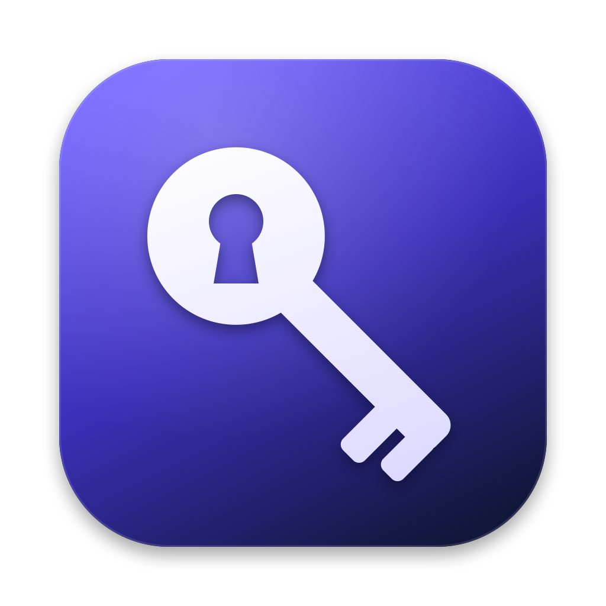

<p align="center">
  
</p>

<h1 align="center">KeyVault</h1>

<p align="center">
  A local-only, encrypted vault for your API keys: a native Mac app, not a command-line tool.<br>
  No cloud, no accounts, no network code, no third-party dependencies.
</p>

---

## What it does

- Stores API keys with a name, service and notes, all encrypted with one master password
- Search, add, edit and delete keys from a native macOS window
- Keys stay hidden until you click **Reveal**. **Copy** puts the key on the clipboard and clears it after 30 seconds
- Locks automatically after inactivity, on sleep, and when your screen locks
- Keeps the last 10 encrypted backups, so you can restore one if the vault file is damaged or deleted

## Requirements

| | |
|---|---|
| **macOS** | 14 Sonoma or later (Apple Silicon or Intel) |
| **Tools** | Apple's Command Line Tools (free, about 1 GB). Full Xcode is **not** needed |
| **Disk** | Under 5 MB for the app |

## Setup

### 1. Install the Command Line Tools (skip if you already have them)

Open **Terminal** and run:

```bash
xcode-select --install
```

A dialog appears. Click **Install** and wait for it to finish. To check that it worked:

```bash
swiftc --version
```

You should see `Apple Swift version …`.

### 2. Get the code

```bash
git clone https://github.com/tanmayhc7/ai-tools.git
```

```bash
cd ai-tools/keyvault
```

### 3. Build the app

```bash
./build.sh
```

This script:
1. draws the app icon,
2. runs the encryption self-tests (each line should say `PASS`),
3. compiles the app into `build/KeyVault.app`.

The first build takes about a minute.

### 4. Open it

```bash
open build/KeyVault.app
```

To keep it in your Applications folder and launch it from Spotlight or Launchpad:

```bash
cp -R build/KeyVault.app /Applications/
```

Because you built the app yourself, macOS opens it without any "unidentified developer" warning.

### 5. Create your vault

On first launch, choose a **master password**. The app enforces:
- at least 12 characters
- nothing close to a common password (`password123` and `P@ssw0rd2024` are rejected)
- enough randomness

**Tip:** four or more random words make a strong password that's still easy to type, e.g. `maple orbit cactus lantern`.

> ⚠️ **There is no password recovery.** No one, including you, can open the vault without the master password. Write it down somewhere safe.

## Using it

| Action | How |
|---|---|
| Add a key | **+** in the toolbar, or <kbd>⌘</kbd><kbd>N</kbd> |
| Copy the selected key | **Copy**, or <kbd>⌘</kbd><kbd>⇧</kbd><kbd>C</kbd> (clipboard clears after 30 s) |
| Show or hide a key | **Reveal** / **Hide** |
| Search | The search field above the list (matches name, service and notes) |
| Lock now | 🔒 in the toolbar, or <kbd>⌘</kbd><kbd>L</kbd> |
| Change auto-lock time | ⚙️ → **Auto-lock After** |
| Change master password | ⚙️ → **Change Master Password…** |
| Back up to another drive | ⚙️ → **Export Encrypted Backup…** |

### Where your data lives

```
~/Library/Application Support/KeyVault/
├── vault.json      ← your encrypted vault
└── Backups/        ← last 10 versions, also encrypted
```

Every file is encrypted. Without your master password, these files are useless to anyone who copies them.

### Restoring a backup

If the vault won't open because the file is damaged, or it was deleted:
1. Open KeyVault.
2. On the lock or setup screen, click **Restore from backup…**.
3. Pick a file. The newest backups are at the top.
4. Unlock it with the master password that was in use when that backup was made.

### Moving to a new Mac

1. On the old Mac, choose ⚙️ → **Export Encrypted Backup…** and copy the file across.
2. On the new Mac, build the app (steps 1 to 4 above) and open it.
3. Click **Restore existing vault from backup…** and choose the file.

### Updating

```bash
cd ai-tools && git pull
```

```bash
cd keyvault && ./build.sh && cp -R build/KeyVault.app /Applications/
```

Your vault is stored separately from the app, so updating never touches your keys.

### Uninstalling

1. Quit KeyVault, then delete the app:
   ```bash
   rm -rf /Applications/KeyVault.app
   ```
2. **Only if you also want your keys gone forever**, delete the vault folder:
   ```bash
   rm -rf ~/Library/Application\ Support/KeyVault
   ```

## Troubleshooting

| Problem | Fix |
|---|---|
| `swiftc: command not found` | Run `xcode-select --install` (step 1) |
| `xcode-select: error: … already installed` | You already have the tools. Go on to step 2 |
| Build fails right after a macOS update | Update the tools: **System Settings → General → Software Update**, or run `xcode-select --install` again |
| "KeyVault is already open" | Only one copy can run at a time (this protects your data). Use the window that's already open |
| "Too many failed attempts" | Wait for the countdown. The delay doubles with each wrong guess, up to 5 minutes |
| "Vault file is damaged" | See **Restoring a backup** above |
| Screenshots of the app come out blank | Intentional. The window is hidden from screen capture |
| Forgot the master password | Unfortunately it can't be recovered; that's what makes the vault secure. Delete the vault folder and start over |

---

## Security design

| Part | How it works |
|---|---|
| Turning your password into a key | **PBKDF2-HMAC-SHA256**, tuned to take about 0.5 s on your Mac (millions of iterations, never fewer than 600,000), with a 16-byte random salt. The password is Unicode-normalised first |
| Encrypting the vault | **AES-256-GCM** (authenticated encryption), with a fresh random nonce on every save |
| Protecting the file's settings | The format, salt and iteration count are bound as GCM associated data, so editing them breaks decryption |
| Storage | File permissions `0600`, folder `0700`. Every save is atomic, so a crash never leaves a half-written file |
| Checking your password | No password hash is stored. A wrong password simply fails GCM authentication |
| Libraries | Apple's CryptoKit and CommonCrypto only. No third-party code |

**Why encryption and not hashing?** A hash is one-way: a hashed API key could never be shown or copied again. Hashing (PBKDF2-SHA256) is used where it belongs, turning your password into the encryption key.

### Attacks tested and how they're handled

The app was attacked as a thief with a copy of the vault file, as malware running on the same Mac, and as someone at the keyboard. Each issue found was fixed, then the attack was run again.

| Attack | Before | Now |
|---|---|---|
| Password guessing on a stolen `vault.json` | `password123` cracked in 1 s | Common or predictable passwords are refused; each guess costs about 4× more; older vaults upgrade automatically on next unlock |
| `DYLD_INSERT_LIBRARIES` code injection | Injected code ran inside the app | Blocked by the hardened runtime |
| Attaching a debugger to read memory | Possible | Hardened runtime without `get-task-allow`, plus `PT_DENY_ATTACH` |
| Tampering with the salt or iteration count | n/a | Rejected; absurd values can't make unlock hang |
| Planting a giant file | Could exhaust memory | Files over 32 MB refused |
| Corrupted or deleted vault | All keys lost | 10 rolling encrypted backups, with restore built in |
| Two copies of the app running | The last save silently overwrote the other | Single-instance lock |
| A password change failing halfway | Could lock you out | The new file is written and verified before switching keys |
| Guessing at the lock screen | Unlimited | Lockout after 3 failures (5 s, doubling up to 5 min) |
| Clipboard | Synced to other devices; left behind on quit | This Mac only, hidden from clipboard managers, cleared after 30 s and on lock or quit |
| Screen recording | Main window only | Every window, including sheets |
| Crash dumps | Could write keys to disk | Disabled |

### What it can't protect against

- **Malware already running as you, or as root.** It can log keystrokes, read the clipboard during the 30-second window, reset the lockout counter, or swap the vault file for an older backup. No app can defend against a compromised account.
- **A weak master password.** The lockout only works inside the app; someone with a copy of the file can guess as fast as their hardware allows. Use 4 or more random words.
- **Secrets in memory while unlocked.** Swift can't reliably wipe strings from memory. Locking drops them, and macOS encrypts swap.

---

## Project layout

```
keyvault/
├── build.sh                 Builds the app and runs the tests
├── Info.plist               App bundle metadata
├── KeyVault.entitlements    Intentionally empty (see build.sh comments)
├── Sources/
│   ├── VaultCrypto.swift    Key derivation and AES-GCM (the security core)
│   ├── PasswordPolicy.swift Master-password strength rules
│   ├── VaultStore.swift     Saving, backups, locking, clipboard
│   ├── KeyVaultApp.swift    App entry point and process hardening
│   ├── AuthViews.swift      Setup and unlock screens
│   ├── VaultViews.swift     Main window, editor, settings
│   └── Local.swift          Lets SwiftUI build without full Xcode
├── tests/main.swift         Crypto and password-policy tests
├── tools/make_icon.swift    Draws the app icon
└── assets/logo.png
```

To run only the tests:

```bash
swiftc -O Sources/VaultCrypto.swift Sources/PasswordPolicy.swift tests/main.swift -o /tmp/kv-tests && /tmp/kv-tests
```
