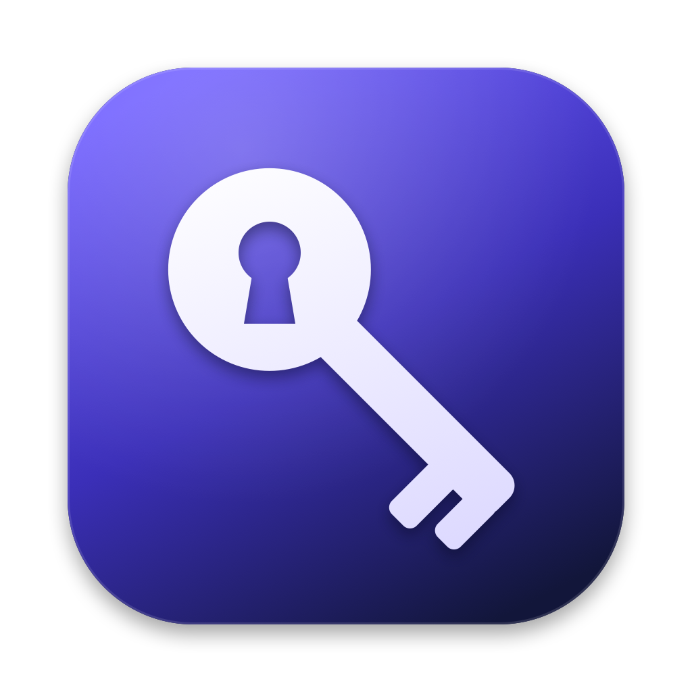

<p align="center">
  
</p>

<h1 align="center">KeyVault</h1>

<p align="center">
  A local-only, encrypted vault for your API keys: a native Mac app, not a command-line tool.<br>
  No cloud, no accounts, no network code, no third-party dependencies.<br>
  Optionally hands one key at a time to your own scripts or AI agents, only when you approve.
</p>

---

## What it does

- Stores API keys with a name, service and notes, all encrypted with one master password
- Search, add, edit and delete keys from a native macOS window
- Keys stay hidden until you click **Reveal**. **Copy** puts the key on the clipboard and clears it after 30 seconds
- Locks automatically after inactivity, on sleep, and when your screen locks
- Keeps the last 10 encrypted backups, so you can restore one if the vault file is damaged or deleted
- **Optional, off by default:** lets a script or AI agent on this Mac ask for one key. You approve each request in KeyVault's own window, and your master password never leaves the app ([details](#letting-scripts-and-ai-agents-use-a-key))

## Requirements

| | |
|---|---|
| **macOS** | 14 Sonoma or later (Apple Silicon or Intel) |
| **Tools** | Apple's Command Line Tools (free, about 1 GB). Full Xcode is **not** needed |
| **Disk** | Under 5 MB for the app |

## Setup

### 1. Install the Command Line Tools (skip if you already have them)

Open **Terminal** and run:

```bash
xcode-select --install
```

A dialog appears. Click **Install** and wait for it to finish. To check that it worked:

```bash
swiftc --version
```

You should see `Apple Swift version …`.

### 2. Get the code

```bash
git clone https://github.com/tanmayhc7/ai-tools.git
```

```bash
cd ai-tools/keyvault
```

### 3. Build the app

```bash
./build.sh
```

This script:
1. draws the app icon,
2. runs the encryption self-tests (each line should say `PASS`),
3. compiles the app into `build/KeyVault.app`.

The first build takes about a minute.

### 4. Open it

```bash
open build/KeyVault.app
```

To keep it in your Applications folder and launch it from Spotlight or Launchpad:

```bash
cp -R build/KeyVault.app /Applications/
```

Because you built the app yourself, macOS opens it without any "unidentified developer" warning.

### 5. Create your vault

On first launch, choose a **master password**. The app enforces:
- at least 12 characters
- nothing close to a common password (`password123` and `P@ssw0rd2024` are rejected)
- enough randomness

**Tip:** four or more random words make a strong password that's still easy to type, e.g. `maple orbit cactus lantern`.

> ⚠️ **There is no password recovery.** No one, including you, can open the vault without the master password. Write it down somewhere safe.

## Using it

| Action | How |
|---|---|
| Add a key | **+** in the toolbar, or <kbd>⌘</kbd><kbd>N</kbd> |
| Copy the selected key | **Copy**, or <kbd>⌘</kbd><kbd>⇧</kbd><kbd>C</kbd> (clipboard clears after 30 s) |
| Show or hide a key | **Reveal** / **Hide** |
| Search | The search field above the list (matches name, service and notes) |
| Lock now | 🔒 in the toolbar, or <kbd>⌘</kbd><kbd>L</kbd> |
| Change auto-lock time | ⚙️ → **Auto-lock After** |
| Change master password | ⚙️ → **Change Master Password…** |
| Back up to another drive | ⚙️ → **Export Encrypted Backup…** |
| Let scripts and agents request keys | ⚙️ → **Agent Access…** (off by default) |

### Where your data lives

```
~/Library/Application Support/KeyVault/
├── vault.json      ← your encrypted vault
└── Backups/        ← last 10 versions, also encrypted
```

Every file is encrypted. Without your master password, these files are useless to anyone who copies them.

### Restoring a backup

If the vault won't open because the file is damaged, or it was deleted:
1. Open KeyVault.
2. On the lock or setup screen, click **Restore from backup…**.
3. Pick a file. The newest backups are at the top.
4. Unlock it with the master password that was in use when that backup was made.

### Moving to a new Mac

1. On the old Mac, choose ⚙️ → **Export Encrypted Backup…** and copy the file across.
2. On the new Mac, build the app (steps 1 to 4 above) and open it.
3. Click **Restore existing vault from backup…** and choose the file.

### Updating

```bash
cd ai-tools && git pull
```

```bash
cd keyvault && ./build.sh && cp -R build/KeyVault.app /Applications/
```

Your vault is stored separately from the app, so updating never touches your keys.

### Uninstalling

1. Quit KeyVault, then delete the app:
   ```bash
   rm -rf /Applications/KeyVault.app
   ```
2. **Only if you also want your keys gone forever**, delete the vault folder:
   ```bash
   rm -rf ~/Library/Application\ Support/KeyVault
   ```

## Letting scripts and AI agents use a key

Some tools need an API key while they run. Typing your master password into them is risky: they don't have KeyVault's protections, so malware could read the password as you type it. Instead, KeyVault can **hand over one key at a time, only after you approve it in KeyVault's own window**. Your master password never leaves the app.

**It's off by default.** Until you switch it on, nothing is listening.

### Turn it on

⚙️ → **Agent Access…** → **Let programs request keys**.

### Use it from Python

The client is a single file with no dependencies: [`agent/keyvault_client.py`](agent/keyvault_client.py). Copy it next to your code, or open it with **Agent Access → Show Python Client in Finder**.

```python
from keyvault_client import get_key, KeyVaultError

api_key = get_key("Anthropic – production", reason="agentp session")
```

`get_key` blocks until you answer. It returns the key, or raises `KeyVaultDenied`, `KeyVaultLocked`, `KeyVaultRateLimited`, `KeyVaultTimeout` or `KeyVaultUnavailable`. All of these are subclasses of `KeyVaultError`. Names match case-insensitively but must otherwise be exact.

### What you'll see

A window in front of everything, naming the key and showing what KeyVault can see about the program asking:
- **Program:** its name and whether its code signature can be verified
- **Location:** where the program file lives
- **Running:** the script or command it was started with
- **In folder:** the folder it's working in
- **Started by:** the app that launched it, such as Terminal
- **The program says:** the `reason` it supplied, clearly labelled as its own words

**Deny** is the default button, so pressing Return refuses. **Allow Once** and **Allow for 10 Minutes** are disabled for the first second and can't be pressed with the keyboard, so a stray click or keystroke can't approve anything. If you do nothing for 60 seconds, the request is refused. If the vault is locked, KeyVault comes to the front and explains which program is waiting; unlock it, and the approval window still appears.

### Rules it enforces

| Rule | Why |
|---|---|
| Only `get` one named key; there is no "list" or "export all" | A program can only ask for what it already knows the name of |
| Refused, unknown and ambiguous names all get the same reply | A program can't probe which keys exist |
| "Allow for 10 minutes" belongs to that one process (process ID + start time) | A child process or a later run is asked again; a reused process ID doesn't inherit it |
| Locking KeyVault (manually, on idle, sleep or screen lock) revokes everything and closes any open request | One action cuts off every agent |
| 3 refusals from one program block it for 5 minutes (doubling for repeat offenders) | Stops a program pestering you |
| 5 refusals from any programs within 10 minutes pause all requests for 5 minutes | Stops a program dodging its block by changing its name to wear you down |
| One request window at a time, at most 5 waiting, 30 requests a minute | Requests can't flood the screen |
| The key is sent only if the requesting process is still connected | A program that quits (or is swapped out) mid-request gets nothing |
| Every request is logged in **Agent Access** (never the key itself) | You can see who asked for what |

### Other languages

The protocol is one line of JSON over the Unix socket at `~/Library/Application Support/KeyVault/agent.sock`:

```
→ {"v":1,"op":"get","key":"Anthropic – production","reason":"optional, shown to you"}
← {"ok":true,"secret":"…"}            or   {"ok":false,"error":"denied"}
```

Error codes are `denied`, `locked`, `rate_limited`, `timeout` and `bad_request`. Keep the connection open until the reply arrives: hanging up early, or shutting down the sending side, cancels the request. Before connecting, check that the socket and its folder are owned by you and not readable by anyone else, as the Python client does.

### What this protects, and what it doesn't

| Concern | With agent access |
|---|---|
| Malware reading the master password from the script | **Protected.** The password is only typed into KeyVault, which blocks code injection and debuggers |
| Password guesses that the app's lockout can't see | **Protected.** There's nothing to guess through the socket, and its counters live in KeyVault's memory, where a script can't reset them |
| Silent access | **Protected.** Nothing is released without your click, and everything is logged |
| The key in the script's memory | **Not protected.** Once approved, the key sits in that program until it exits, and Python can't wipe it. Prefer **Allow Once**, and quit agents you're done with |
| A prompt-injected agent | **Not protected by KeyVault.** If an agent can run shell commands, a malicious prompt can make it read files or send data out. Keep the key out of child-process environments, and run agents in a sandbox |
| Which script is asking | **Partly.** KeyVault shows the interpreter, script path and folder, but an unsigned interpreter can't prove which script it runs. Approve only what you just started |

## Troubleshooting

| Problem | Fix |
|---|---|
| `swiftc: command not found` | Run `xcode-select --install` (step 1) |
| `xcode-select: error: … already installed` | You already have the tools. Go on to step 2 |
| Build fails right after a macOS update | Update the tools: **System Settings → General → Software Update**, or run `xcode-select --install` again |
| "KeyVault is already open" | Only one copy can run at a time (this protects your data). Use the window that's already open |
| "Too many failed attempts" | Wait for the countdown. The delay doubles with each wrong guess, up to 5 minutes |
| "Vault file is damaged" | See **Restoring a backup** above |
| Screenshots of the app come out blank | Intentional. The window is hidden from screen capture |
| `KeyVaultUnavailable` from Python | Open KeyVault and turn on ⚙️ → **Agent Access** → **Let programs request keys** |
| `KeyVaultRateLimited` | Too many refusals or requests; wait a few minutes. **Agent Access** shows what happened |
| The Agent Access switch turns itself off | Something other than KeyVault's socket is at `~/Library/Application Support/KeyVault/agent.sock`. KeyVault never deletes it; the message in the panel says what's there |
| Forgot the master password | Unfortunately it can't be recovered; that's what makes the vault secure. Delete the vault folder and start over |

---

## Security design

| Part | How it works |
|---|---|
| Turning your password into a key | **PBKDF2-HMAC-SHA256**, tuned to take about 0.5 s on your Mac (millions of iterations, never fewer than 600,000), with a 16-byte random salt. The password is Unicode-normalised first |
| Encrypting the vault | **AES-256-GCM** (authenticated encryption), with a fresh random nonce on every save |
| Protecting the file's settings | The format, salt and iteration count are bound as GCM associated data, so editing them breaks decryption |
| Storage | File permissions `0600`, folder `0700`. Every save is atomic, so a crash never leaves a half-written file |
| Checking your password | No password hash is stored. A wrong password simply fails GCM authentication |
| Libraries | Apple's CryptoKit and CommonCrypto only. No third-party code |

**Why encryption and not hashing?** A hash is one-way: a hashed API key could never be shown or copied again. Hashing (PBKDF2-SHA256) is used where it belongs, turning your password into the encryption key.

### Attacks tested and how they're handled

The app was attacked as a thief with a copy of the vault file, as malware running on the same Mac, and as someone at the keyboard. Each issue found was fixed, then the attack was run again.

| Attack | Before | Now |
|---|---|---|
| Password guessing on a stolen `vault.json` | `password123` cracked in 1 s | Common or predictable passwords are refused; each guess costs about 4× more; older vaults upgrade automatically on next unlock |
| `DYLD_INSERT_LIBRARIES` code injection | Injected code ran inside the app | Blocked by the hardened runtime |
| Attaching a debugger to read memory | Possible | Hardened runtime without `get-task-allow`, plus `PT_DENY_ATTACH` |
| Tampering with the salt or iteration count | n/a | Rejected; absurd values can't make unlock hang |
| Planting a giant file | Could exhaust memory | Files over 32 MB refused |
| Corrupted or deleted vault | All keys lost | 10 rolling encrypted backups, with restore built in |
| Two copies of the app running | The last save silently overwrote the other | Single-instance lock |
| A password change failing halfway | Could lock you out | The new file is written and verified before switching keys |
| Guessing at the lock screen | Unlimited | Lockout after 3 failures (5 s, doubling up to 5 min) |
| Clipboard | Synced to other devices; left behind on quit | This Mac only, hidden from clipboard managers, cleared after 30 s and on lock or quit |
| Screen recording | Main window only | Every window, including sheets |
| Crash dumps | Could write keys to disk | Disabled |

**Agent access** was attacked separately: 123 engine tests and 30 tests of the real app model in a throwaway home folder. One real bug was found and fixed along the way.

| Attack on agent access | Result |
|---|---|
| Garbage, binary junk, 20 KB requests, half-sent requests that stall | Rejected within 5 seconds; repeat offenders blocked before any window appears |
| 400 hostile connections in a burst | Server keeps answering, no file descriptors leaked |
| Program quits while you're deciding | Key is not fetched or sent, even if you click Allow |
| Vault locks while a request window is open | Window closes; nothing released, even for an already-clicked Allow |
| Requests from a program after its process ID is reused | Treated as a new program |
| Fake lines or right-to-left tricks in names and reasons | Control, invisible and direction-override characters are stripped before display |
| Endless request windows to wear you down | Paused after 5 refusals in 10 minutes |
| Stray click or keystroke approving | Allow buttons wait 1 second and can't take keyboard focus; Return means Deny |
| A file, folder or symlink planted where the socket goes | KeyVault refuses to start the feature and leaves it untouched |
| A second listener on the socket | Never taken over |
| A different user account connecting | Dropped before anything is looked up |
| **Bug found:** the request window could sit under other apps' panels | Fixed: it now uses the modal-panel level |

### What it can't protect against

- **Malware already running as you, or as root.** It can log keystrokes, read the clipboard during the 30-second window, reset the lockout counter, or swap the vault file for an older backup. No app can defend against a compromised account.
- **A weak master password.** The lockout only works inside the app; someone with a copy of the file can guess as fast as their hardware allows. Use 4 or more random words.
- **Secrets in memory while unlocked.** Swift can't reliably wipe strings from memory. Locking drops them, and macOS encrypts swap.
- **A key you approved for an agent.** It lives in that program until it exits. See [what agent access protects](#what-this-protects-and-what-it-doesnt).

---

## Project layout

```
keyvault/
├── build.sh                 Builds the app and runs the tests
├── Info.plist               App bundle metadata
├── KeyVault.entitlements    Intentionally empty (see build.sh comments)
├── Sources/
│   ├── VaultCrypto.swift        Key derivation and AES-GCM (the security core)
│   ├── PasswordPolicy.swift     Master-password strength rules
│   ├── VaultStore.swift         Saving, backups, locking, clipboard
│   ├── KeyVaultApp.swift        App entry point and process hardening
│   ├── AuthViews.swift          Setup and unlock screens
│   ├── VaultViews.swift         Main window, editor, settings
│   ├── AgentProtocol.swift      Agent access: message format, name matching, text sanitising
│   ├── ProcessInspector.swift   Agent access: who is asking (path, script, folder, signature)
│   ├── AccessController.swift   Agent access: approvals, grants, throttling, log
│   ├── AgentServer.swift        Agent access: the Unix socket
│   ├── AgentAccess.swift        Agent access: on/off switch and link to the vault
│   ├── ApprovalPresenter.swift  Agent access: the request window
│   ├── AgentViews.swift         Agent access: settings panel
│   ├── Foreground.swift, Logo.swift
│   └── Local.swift              Lets SwiftUI build without full Xcode
├── agent/
│   ├── keyvault_client.py       Python client (standard library only)
│   └── tests/test_client.py     16 client tests
├── tests/
│   ├── main.swift               25 crypto and password-policy tests
│   ├── agent/main.swift         123 agent-access tests (real sockets, real processes)
│   └── integration/main.swift   30 tests of the real app model in a throwaway home folder
├── tools/make_icon.swift        Draws the app icon
└── assets/logo.png
```

`./build.sh` runs all 194 tests before building. None of them touch your real vault.
