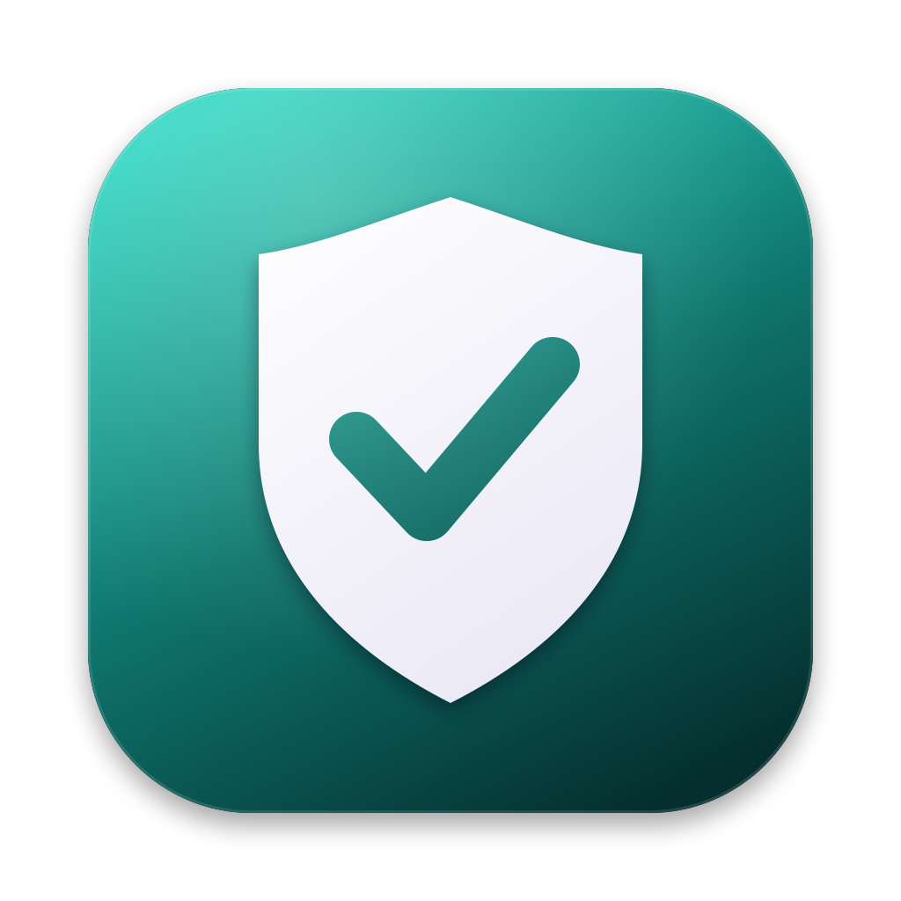

<p align="center">
  
</p>

<h1 align="center">LeakGuard</h1>

<p align="center">
  Find API keys and passwords that leaked into your code, including ones hidden in old git commits.<br>
  A native Mac app. Everything runs on your machine; nothing is uploaded.
</p>

---

## What it does

- **Scans a project folder** for API keys, tokens, private keys and passwords: OpenAI, Anthropic, AWS, GitHub, GitLab, Stripe, Google, Slack, Hugging Face, Groq, Replicate, SendGrid, Twilio, npm, database URLs and more
- **Scans the full git history.** A key you deleted last month is still in your commits, and LeakGuard finds the commit it came from
- **Checks against your [KeyVault](../keyvault/)** (optional). Finds your exact stored keys even when they don't match a known format
- **Blocks future leaks** with a one-click git pre-commit hook that refuses any commit adding a key
- **Never shows full secrets.** Results show only a masked preview like `sk-p••••••••Ab3x`

## Requirements

| | |
|---|---|
| **macOS** | 14 Sonoma or later (Apple Silicon or Intel) |
| **Tools** | Apple's free Command Line Tools (these include `git`). Full Xcode is **not** needed |

## Setup

**1. Install the Command Line Tools** (skip if you already have them):

```bash
xcode-select --install
```

**2. Get the code and build:**

```bash
git clone https://github.com/tanmayhc7/ai-tools.git
```

```bash
cd ai-tools/leakguard && ./build.sh
```

The script draws the icon, runs 67 self-tests (every line should say `PASS`), and builds `build/LeakGuard.app`.

**3. Open it, or install it in Applications:**

```bash
open build/LeakGuard.app
```

```bash
cp -R build/LeakGuard.app /Applications/
```

## Using it

1. **Drop a project folder** onto the window, or click **Choose Folder…**.
2. Choose what to check:
   - **Git history**: every past commit (on by default when the folder is a git repo)
   - **My KeyVault keys**: asks for your KeyVault master password, then looks for your exact keys
3. Click **Scan** (<kbd>⌘</kbd><kbd>R</kbd>).

Results are grouped by file. Each shows the kind of key, the line, a masked preview, and whether it's in your **current files** or only in a **past commit**. Right-click a result to copy its location or commit ID.

### When something is found

1. **Rotate the key first.** Create a new key in the provider's dashboard and revoke the old one. Assume a leaked key is already compromised.
2. **Move it out of the code**, into an environment variable or a git-ignored `.env` file.
3. **If it's only in history:** deleting a file doesn't remove it from past commits. After rotating, rewrite history with [`git filter-repo`](https://github.com/newren/git-filter-repo) if the repository is shared.

### The pre-commit hook

Click **Install Pre-commit Hook** in the side panel. From then on, `git commit` refuses any commit that adds what looks like a key:

```
✗ LeakGuard blocked this commit. It adds what looks like a secret in:
    config/settings.py
```

For a false positive, bypass once with `git commit --no-verify`. The hook supports tools that change the hooks folder (such as Husky). LeakGuard never overwrites a hook it didn't install.

## Robustness and security

Scanning a folder you didn't create is risky: a repository can be booby-trapped. LeakGuard was attacked deliberately, and each finding was fixed and re-tested.

| Attack | Before | Now |
|---|---|---|
| Repo config that runs a program via **commit-signature verification** (`log.showSignature` + `gpg.program`) | **Ran the attacker's program** | Blocked: verification forced off, signing tools replaced with `/usr/bin/false` |
| Repo config with diff tools, `textconv` filters, `fsmonitor` hooks or pagers | n/a | Blocked: disabled on every git call |
| Crafted text that makes patterns take quadratic time (e.g. `token` repeated 200,000×) | **Froze for over 100 s** | Under 1 s: every pattern has an upper length bound |
| Thousands of fake `BEGIN PRIVATE KEY` headers | 7.8 s | 1 s: one linear pass plus binary search |
| Symlinks pointing outside the folder | n/a | Never followed |
| File swapped for a named pipe or symlink mid-scan | n/a | Files are opened once and checked through the open handle |
| Huge files, minified one-line files, invalid UTF-8, binaries | n/a | Size caps, chunked scanning, lossy decoding, binary detection |
| Huge histories | n/a | Streamed line by line (never loaded whole), 10-minute cap, results capped at 5,000 |
| Guessing your KeyVault password through LeakGuard | Unlimited | Shares KeyVault's own lockout (5 s, doubling up to 5 min) |
| KeyVault keys left in memory | n/a | Decrypted for one scan only; results keep just a masked preview and a short hash |

Other details:
- Git runs with a clean, minimal environment and never prompts or touches the network.
- File names with spaces, quotes or non-English characters are decoded correctly.
- The app is built with the hardened runtime, so code can't be injected into it.

### Limits

- Pattern matching catches known key formats plus random-looking `key = "..."` assignments. A key in an unusual format with an innocent variable name can be missed; that's what the **KeyVault check** is for.
- Files over 5 MB and binary files (images, archives) are skipped.
- Very short KeyVault entries (under 12 characters) aren't searched, to avoid false alarms.

## Troubleshooting

| Problem | Fix |
|---|---|
| `swiftc: command not found` | Run `xcode-select --install` |
| "Git isn't installed, so history scanning is off" | Run `xcode-select --install` |
| "This repo already has a pre-commit hook" | Add LeakGuard's check to your existing hook by hand, or remove the old hook first |
| "History not fully scanned: dubious ownership" | Git refuses repos owned by another user account. Run `git config --global --add safe.directory <path>` if you trust it |
| "My KeyVault keys" is greyed out | No KeyVault vault was found on this Mac. Set up [KeyVault](../keyvault/) first |

## Project layout

```
leakguard/
├── build.sh                 Builds the app and runs the tests
├── Sources/
│   ├── SecretRules.swift    Key-detection patterns (shared with Redact and ContextPack)
│   ├── Scanner.swift        Folder and git-history scanning
│   ├── GitRunner.swift      Runs git safely against untrusted repos
│   ├── SafeRead.swift       Race-free, non-blocking file reads
│   ├── HookInstaller.swift  Pre-commit hook
│   ├── VaultReader.swift    Read-only KeyVault access
│   ├── VaultCrypto.swift    KeyVault's encryption (copied from keyvault/)
│   ├── LeakGuardApp.swift   App state
│   ├── LeakGuardViews.swift Interface
│   └── Local.swift          Lets SwiftUI build without full Xcode
├── tests/main.swift         67 tests, including booby-trapped repos
└── tools/make_icon.swift    Draws the app icon
```
