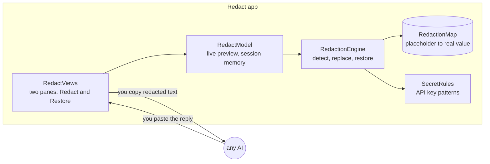
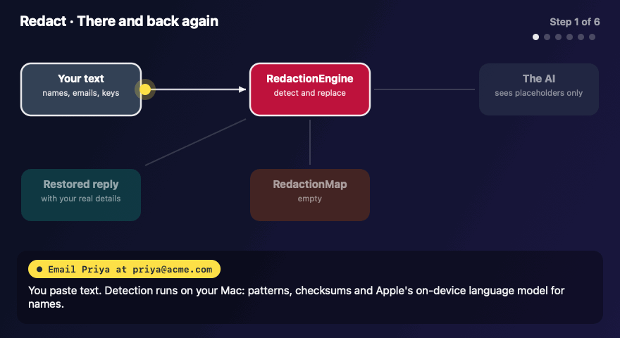
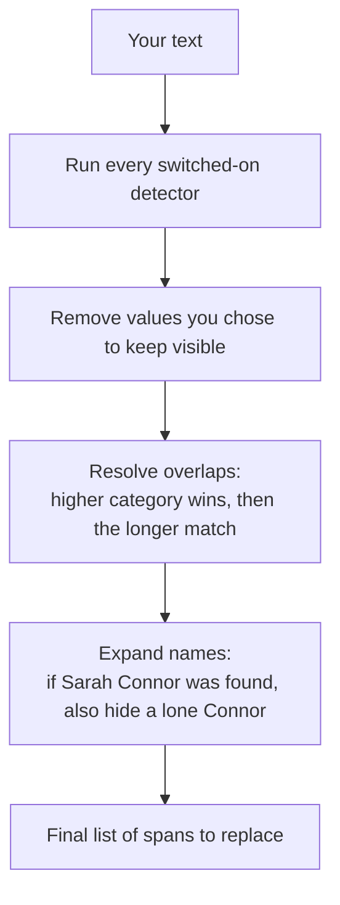
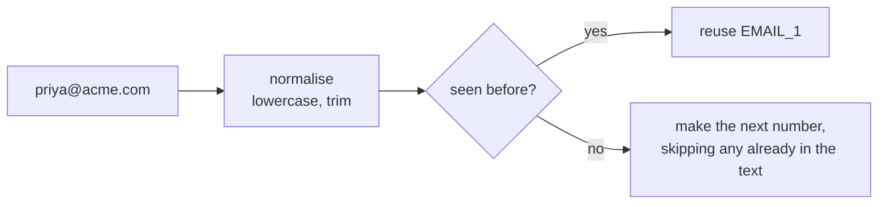
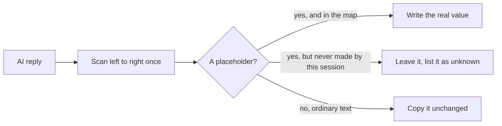

<p align="center">
  
</p>

<h1 align="center">Redact: how it works inside</h1>

<p align="center">
  A guided tour of the code, for anyone who wants to understand it, check it, or change it.<br>
  No security background needed. New words are explained where they first appear.
</p>

---

## In one minute

Redact lets you use an AI on real documents without handing over the real details.

1. **You paste text.** Redact finds the private parts (names, emails, card numbers, API keys…) and swaps each for a placeholder like `[EMAIL_1]`.
2. **You paste the redacted text into any AI.** It only ever sees placeholders.
3. **You paste the AI's answer back.** Redact swaps the placeholders for your real values.
4. **The list of "which placeholder means what" lives only in memory.** Quit the app and it is gone.

So there are really only two operations, **redact** and **restore**, plus a memory (the *map*) that connects them.

## The big picture



Nothing connects Redact to the AI. **You** are the courier, so you always see exactly what leaves your Mac.

## Watch a round trip

<p align="center">
  
</p>

<details>
<summary><b>The same steps in words</b></summary>

1. You paste text. Detection runs on your Mac: patterns, checksums and Apple's on-device language model for names.
2. Each value gets a placeholder. The same value always gets the same one. The mapping lives in memory only.
3. You copy the redacted text into any AI. That is the only thing that leaves your Mac, and you are the one who pastes it.
4. You paste the answer back. Restore recognises placeholders even if the AI changed their case, spacing or escaped them.
5. One left-to-right pass swaps the real values back in. Placeholders it never created are left alone and listed.
6. You get the answer with your real details. Quit or press Clear All and the mapping is gone for good.

</details>

## Where everything lives

| File | What it does |
|---|---|
| `RedactionEngine.swift` | **The core, with no screen code.** Finds private data, makes placeholders, and restores them. Fully tested. Shared with ChatKeep |
| `SecretRules.swift` | API-key patterns (the same detector LeakGuard uses) |
| `RedactApp.swift` | App entry point, and `RedactModel`: the live preview, the session memory, opening files |
| `RedactViews.swift` | The two panes, the sidebar of what was hidden, switches and custom words |
| `Local.swift` | A small stand-in for a SwiftUI feature that needs full Xcode |

## Part 1: Finding private data (`RedactionEngine.detect`)

There are 13 **categories**. Each is found a different way:

| Category | Placeholder | On by default | How it is found |
|---|---|---|---|
| API keys and passwords | `[SECRET_n]` | yes | the shared `SecretRules` patterns |
| Your own words | `[TERM_n]` | yes | exact whole-word match of what you typed |
| Email addresses | `[EMAIL_n]` | yes | a pattern |
| Card numbers | `[CARD_n]` | yes | a pattern **plus** the Luhn checksum |
| Bank accounts | `[IBAN_n]` | yes | a pattern **plus** the mod-97 checksum |
| US social security numbers | `[ID_n]` | yes | a pattern that rules out impossible numbers |
| IP addresses | `[IP_n]` | yes | patterns for IPv4 and IPv6 (loopback left alone) |
| Phone numbers | `[PHONE_n]` | yes | Apple's built-in data detector |
| Street addresses | `[ADDRESS_n]` | yes | Apple's built-in data detector |
| People's names | `[NAME_n]` | yes | Apple's on-device language model (`NLTagger`) |
| Web links | `[URL_n]` | **no** | Apple's data detector |
| Organisations | `[ORG_n]` | **no** | the language model |
| Places | `[PLACE_n]` | **no** | the language model |

The last three start off because the AI usually needs them for context.

**Checksums stop false alarms.** Any 16-digit number *looks* like a card, but only about 1 in 10 passes the Luhn test, and an IBAN must satisfy a modular-arithmetic rule. So an order number isn't hidden by mistake.

### The detection pipeline



- **Overlaps.** An email also contains a name-like word; a key can look like a phone number. The category order in the enum (`secret`, `custom`, `email`, `card`…) *is* the priority.
- **Names get hidden everywhere.** The language model may spot "Sarah Connor" once and miss a later bare "Connor". After the first pass, every other whole-word occurrence of each found name, and of its capitalised parts, is hidden too.

> [!NOTE]
> Name detection is the one fuzzy part. The language model is good in full sentences and can miss names in short fragments. That is why the app has **Always hide these words**, which is exact and guaranteed.

## Part 2: Placeholders and the memory (`RedactionMap`)

The map is two dictionaries: placeholder → real value, and real value → placeholder.



- **Same value, same placeholder.** `Priya` and `priya` become one `[NAME_1]`. Card and phone numbers are compared digits-only, so `4111 1111 1111 1111` and `4111-1111-1111-1111` match.
- **Never collide with your text.** If your text already contains `[EMAIL_1]`, Redact skips to `[EMAIL_2]`, so restoring can't touch your own text.

### Why there are two maps

While you type, the preview re-runs constantly. If every keystroke used up placeholder numbers, you'd end up with `[NAME_14]` for something you only half typed. So `RedactModel` keeps:

| Map | Used for |
|---|---|
| `committedMap` | numbers already **handed to an AI** (locked in when you press Copy) |
| `previewMap` | the live preview, built on top of the committed one |

Pressing **Copy** promotes the preview to committed. **Clear All** (⌘K) wipes both. Typing waits for a pause first (0.2 seconds, or 0.5 for very long text) and runs off the main thread so the window never freezes.

## Part 3: Putting values back (`RedactionEngine.restore`)

AIs rewrite things. They may write `[email_1]`, `[ EMAIL_1 ]`, `EMAIL_1`, or `\[EMAIL\_1\]` (Markdown-escaped). One pattern recognises all of those. Then:



**A single pass matters.** If a real value itself looked like a placeholder (say you redacted the literal text `[EMAIL_2]`), swapping repeatedly would expand it again. Reading left to right once, writing real values straight to the output, can't do that.

Also: `[NAME_10]` is never confused with `[NAME_1]`, and bracketed words like `[MAX_2]` that aren't placeholders are left alone.

## Part 4: The app around it

- **Opening files.** Text, RTF, Word and ODT documents (through macOS's own readers) and PDFs (PDFKit). Limits: 20 MB and 2 million characters. **HTML is read as plain text on purpose**: macOS's HTML importer goes through a web engine that can fetch remote images, which would reveal that you opened the file.
- **What is saved.** Only which categories are switched on. Your text, placeholders, custom words and "keep visible" choices are deliberately **not** saved, because they are sensitive themselves.
- **Clipboard.** Restored text contains your real data again, so it is copied marked as private to clipboard managers and never syncs to your other devices.
- **Windows** are hidden from screenshots and screen recordings.

## Tests

`./build.sh` runs all **49** tests (`tests/main.swift`) before building.

| Group | What it covers |
|---|---|
| Detection | each category, valid versus invalid checksums, times like `12:30:45` and C++ `std::vector` not mistaken for IP addresses |
| Names and words | names hidden everywhere, accented names, custom words as whole words only, the keep-visible list |
| Placeholder safety | never reuse a number already in the text; stable across separate pastes |
| Restore | any spelling of a placeholder, markdown-escaped, unknown ones, single pass, `NAME_10` vs `NAME_1` |
| Robustness | empty text, emoji and combining accents (ranges stay correct), 430 KB of text, and **hostile text built to slow patterns down** |

```bash
swiftc -O Sources/SecretRules.swift Sources/RedactionEngine.swift tests/main.swift -o /tmp/rd-tests && /tmp/rd-tests
```

## Changing things safely

<details>
<summary><b>Add a new category (say, passport numbers)</b></summary>

1. In `RedactionEngine.swift`, add a case to `Category` and fill in its `label`, `prefix` (for example `"PASSPORT"`) and, if it should start off, `enabledByDefault`. **Its position in the list is its priority.**
2. In `detect`, add a block that finds it, guarded by `if on.contains(.passport)`. Use a **bounded** pattern, and a validator if the number has a checksum.
3. If normalisation matters (spaces, dashes), add it to `RedactionMap.normalize`.
4. Add tests: found, near-miss not found, redact then restore round trip.
5. If you copied this file into another tool, copy it again (`tools/check-shared.sh` tells you).

The sidebar switches and the restore recogniser are built from `Category.allCases`, so they pick the new category up automatically.

</details>

<details>
<summary><b>Make names detection stricter or looser</b></summary>

It is the `NLTagger` block in `detect`. Raising the minimum length (`count >= 2`) cuts false positives; the "expand names" step below it decides how aggressively a found name is hidden elsewhere.

</details>

## Gotchas

- **Don't make the pattern unbounded.** `{1,}`, `+` and `*` on user text can be made slow on purpose. Use `{1,64}`-style limits (there is a test that feeds hostile text to every pattern).
- **Never save text or the map.** It would defeat the purpose.
- **Keep `restore` single-pass.** It is a correctness property, not an optimisation.
- **Don't open HTML through macOS's importer.** See "Opening files".
- **Shared copies.** `SecretRules.swift` and `RedactionEngine.swift` are used by other tools. Edit the original, copy, run `tools/check-shared.sh`.

## Glossary

| Word | Plain meaning |
|---|---|
| **Placeholder** | A harmless stand-in such as `[NAME_1]` |
| **Redact** | Replace private details with placeholders |
| **Restore** | Replace the placeholders with the real details again |
| **Luhn check** | The standard checksum on card numbers |
| **IBAN check** | The standard checksum on international bank account numbers |
| **On-device model** | A language model that runs on your Mac and sends nothing anywhere |
| **Debounce** | Waiting for you to stop typing before doing the work |

---

<p align="center">
  <sub>Part of <a href="../README.md">ai-tools</a> · back to <a href="README.md">Redact</a> · licensed under the <a href="../LICENSE">GNU AGPL v3</a></sub>
</p>
